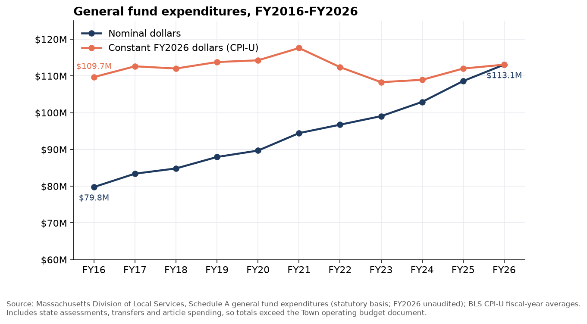
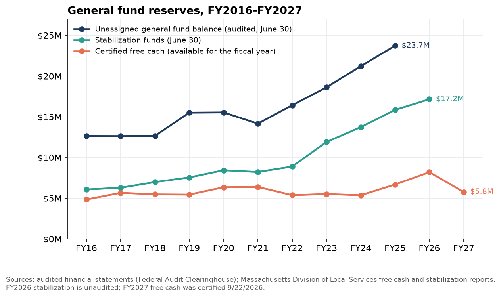
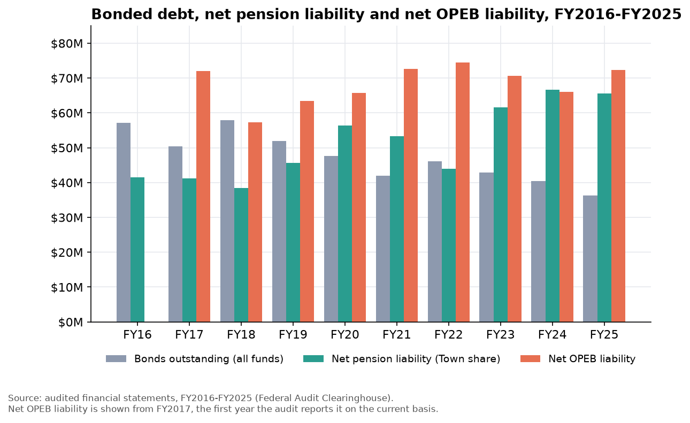
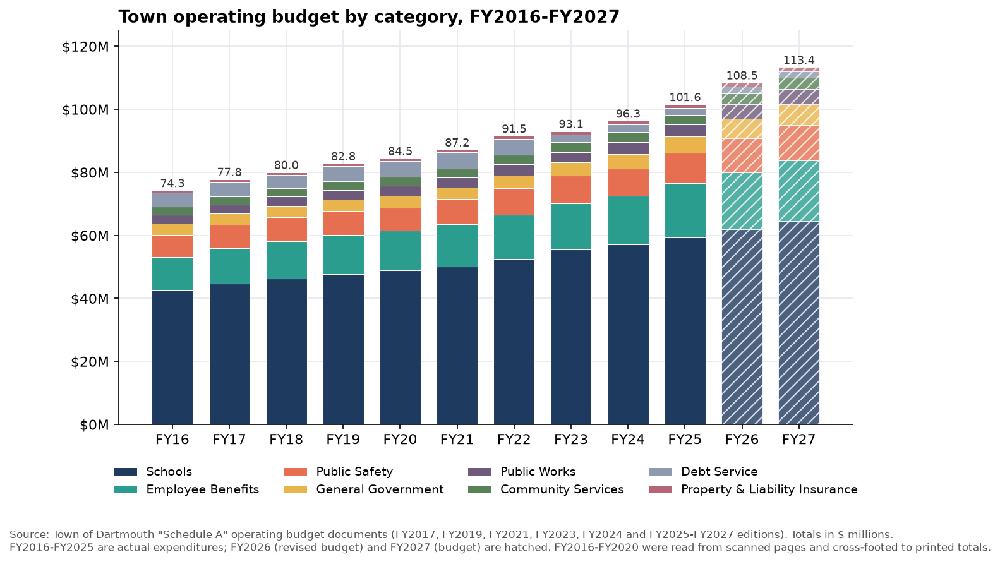
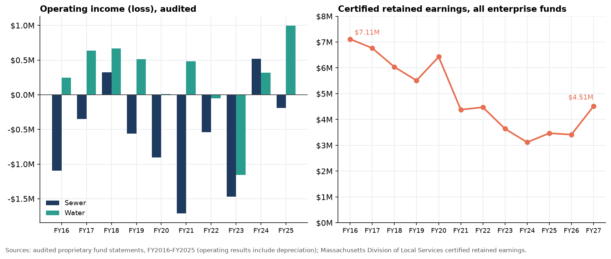
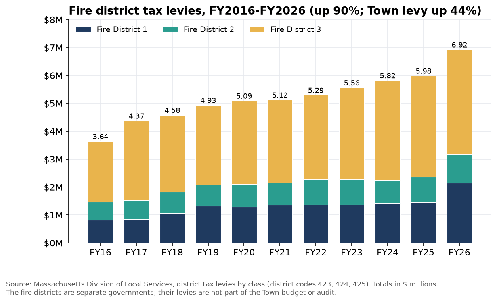
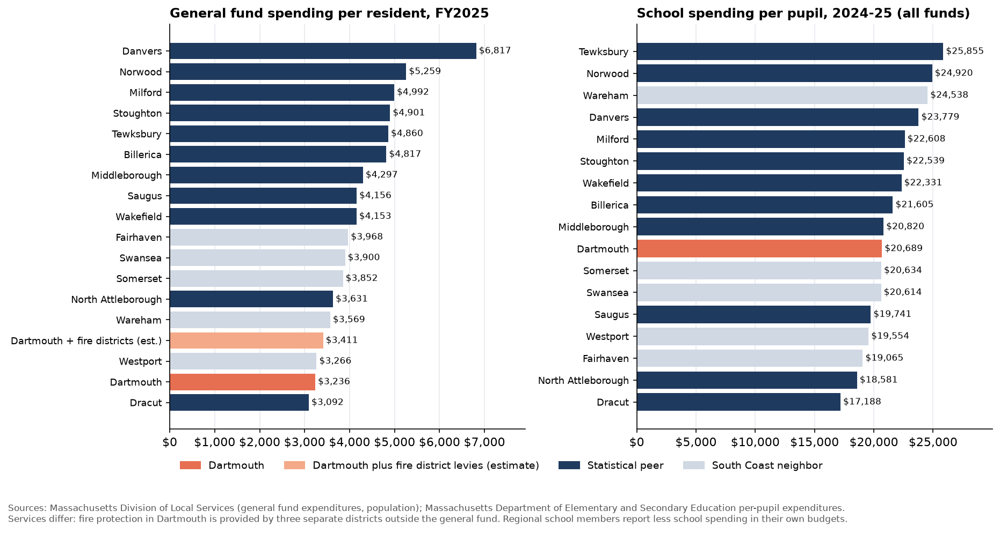
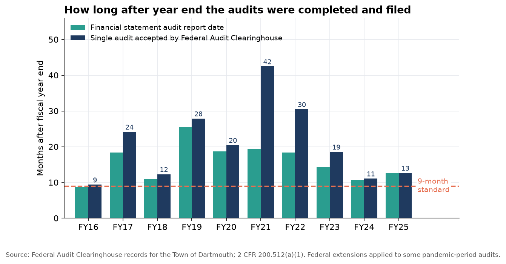

# Dartmouth, Massachusetts: Municipal Financial Baseline, FY2016 to FY2027

Prepared November 10, 2026 for an independent civic transparency initiative. Scope: Town of Dartmouth general fund, enterprise funds, debt, reserves, long-term obligations, audits and governance for fiscal years 2016 through 2026, with the adopted FY2027 budget. A Massachusetts fiscal year runs July 1 to June 30; FY2026 ended June 30, 2026.

## How to read this report

Every finding carries one of three evidence labels.

- **Verified**: taken directly from a primary record (Town document, audited financial statement, state or federal dataset) that is linked with its date and page or section.
- **Hypothesis**: a reasonable inference from verified facts that has not been confirmed. Each hypothesis names the record that would test it.
- **Unavailable**: information that was looked for and not located in public sources as of November 10, 2026.

Figures marked "derived" are arithmetic performed on verified figures (for example inflation adjustment, per-resident amounts, sums and percentage changes). No figure in this report is estimated without being labelled, and nothing here is a finding of misconduct. All tables are also provided as CSV files in the `data/` folder; the file `README.md` is the data dictionary.

**Review status.** The figures were extracted by an AI research assistant and checked against the original records (page-level text matches for audited figures, cross-footing for budgets, structured Clearinghouse fields for audit attributes). They have not yet been independently checked by a person. The project repository reserves the status "Verified finding" for claims that are "supported by authoritative records and independently checked" and requires a human-reviewed audit trail for AI-assisted work ([repository research standards](https://github.com/MollyB1589/townofdartmouth/blob/main/research/RESEARCH_STANDARDS.md), accessed 2026-11-11, Finding statuses; AI use). Until a person has spot-checked the cited pages, items labelled Verified here should enter the repository as "Needs verification", hypotheses as "Hypothesis", and the document inventory as "Source collected". Corrections made during preparation are listed in the corrections log near the end of this report.

| Label in this report | Repository status on intake | Repository status after a human spot-check of the cited page |
|---|---|---|
| Verified | Needs verification | Verified finding |
| Verified (secondary source) | Needs verification | Needs verification until a primary record is obtained |
| Hypothesis (H1 to H7) | Hypothesis | Hypothesis until the named record is obtained |
| Unavailable | Needs verification (records request pending) | Unchanged until records are produced |
| Document inventory rows | Source collected | Source collected |
| Entries in the corrections log | Closed / corrected | Closed / corrected |

Three accounting bases appear and should not be mixed:

| Basis | Where it comes from | Use in this report |
|---|---|---|
| State Schedule A (statutory basis) | Annual report the Town files with the Division of Local Services (DLS) ([DLS Schedule A general fund report](https://dlsgateway.dor.state.ma.us/reports/rdPage.aspx?rdReport=ScheduleA.GeneralFund), accessed 2026-11-10) | Longest consistent series (FY2016 to FY2026) and the only one comparable across towns. FY2026 is unaudited. |
| Audited statements (GAAP) | Independent audits filed with the Federal Audit Clearinghouse, FY2016 to FY2025 ([Federal Audit Clearinghouse records](https://app.fac.gov/dissemination/search/), accessed 2026-11-10) | Fund balances, debt, pension and OPEB liabilities, enterprise fund results, budget-to-actual schedules. |
| Town budget documents | "Schedule A" operating budget voted by Town Meeting ([Town Budget Information page](https://www.dartmouthma.gov/617/Budget-Information), accessed 2026-11-10) | Department-level detail. Narrower than the state report because it excludes state and county assessments, transfers and separate warrant articles. |

## Executive summary of verified findings

Dartmouth's finances over the decade show strong reserves, falling debt, clean audit opinions and low spending relative to comparable towns. The principal pressures are long-term: retiree health (OPEB) and pension obligations, employee benefit costs growing faster than the budget, thin enterprise fund reserves, a tax levy at its legal limit, and a planning scenario of about $516.5 million in future borrowing. The main documented weaknesses are in financial reporting timeliness and public access to financial records. No evidence of misconduct was found, and none is asserted.

1. **Spending grew 41.8% in nominal terms and 3.1% after inflation.** General fund expenditures reported to the state rose from $79.77M in FY2016 to $113.07M in FY2026 (unaudited). In FY2026 dollars that is $109.7M to $113.1M; inflation-adjusted spending peaked in FY2021 at $117.6M. Per resident, real spending went from $3,160 to $3,312 ([DLS Schedule A general fund report](https://dlsgateway.dor.state.ma.us/reports/rdPage.aspx?rdReport=ScheduleA.GeneralFund), accessed 2026-11-10); inflation adjustment is derived from the national consumer price index ([BLS consumer price index series](https://download.bls.gov/pub/time.series/cu/cu.data.1.AllItems), accessed 2026-11-10). Verified; real figures derived.
2. **Education and employee benefits take a growing share; debt service a shrinking one.** Education rose from 55.0% to 56.7% of general fund spending, fixed costs (pensions, health insurance and other benefits) from 12.5% to 16.4%, and debt service fell from 5.6% to 1.6% ([DLS Schedule A general fund report](https://dlsgateway.dor.state.ma.us/reports/rdPage.aspx?rdReport=ScheduleA.GeneralFund), accessed 2026-11-10). In the Town's own budget documents, FY2022 actual to FY2027 budget, the operating total grew 24% while Employee Benefits grew 37% (the Health and Life Insurance line 49%), General Government 68% (55% excluding the Reserve Fund line), Public Safety 33% and Schools 23%, and Debt Service fell 62% ([FY2027 Town operating budget](https://www.dartmouthma.gov/DocumentCenter/View/7315/FY-2027-Budget), dated 2026-05 (June 2, 2026 Town Meeting), category summary lines) ([FY2025 Town operating budget](https://www.dartmouthma.gov/DocumentCenter/View/6215/2024-Budget), dated 2024-05-20, FY2022 actual column). Verified.
3. **The property tax levy is at its legal limit.** The levy grew from $56.17M to $80.88M (44%), with unused levy capacity never above $89,152 in any year ([DLS levy limit report](https://dlsgateway.dor.state.ma.us/reports/rdPage.aspx?rdReport=Prop2.5.ExcessLevyCapandOverride_10_pres), accessed 2026-11-10). New growth added to the levy fell from $1.38M to $0.82M ([DLS new growth report](https://dlsgateway.dor.state.ma.us/reports/rdPage.aspx?rdReport=Dashboard.Cat_3_Reports.NewGrowthByClass351), accessed 2026-11-10). The average single-family tax bill rose from $3,578 to $5,276 (7.2% after inflation, derived) while the residential rate fell from $9.84 to $8.03 per $1,000 as values rose ([DLS average single-family tax bill report](https://dlsgateway.dor.state.ma.us/reports/rdPage.aspx?rdReport=AverageSingleTaxBill.SingleFamTaxBill_wRange), accessed 2026-11-10) ([DLS tax rate report](https://dlsgateway.dor.state.ma.us/reports/rdPage.aspx?rdReport=PropertyTaxInformation.taxratesbyclass.taxratesbyclass), accessed 2026-11-10). State records show the last operating override questions on June 30, 2008 and the last debt exclusion (police station) on April 4, 2017 ([DLS override vote records](https://dlsgateway.dor.state.ma.us/reports/rdPage.aspx?rdReport=Votes.Prop2_5.OverrideUnderride), accessed 2026-11-10) ([DLS debt exclusion vote records](https://dlsgateway.dor.state.ma.us/reports/rdPage.aspx?rdReport=Votes.Prop2_5.DebtExclusionVotes), accessed 2026-11-10). Verified.
4. **Reserves have grown.** Certified free cash ranged from $4.84M to $8.20M every year and was $5.76M for FY2027, certified September 22, 2026 ([DLS certified free cash report](https://dlsgateway.dor.state.ma.us/reports/rdPage.aspx?rdReport=FreeCash2), accessed 2026-11-10). Stabilization funds grew from $6.06M to $17.16M ([DLS stabilization fund report](https://dlsgateway.dor.state.ma.us/reports/rdPage.aspx?rdReport=Dashboard.Cat_1_Reports.StablPerBudget351), accessed 2026-11-10). The audited unassigned general fund balance grew from $12.64M to $23.73M ([FY2025 audit package](https://app.fac.gov/dissemination/report/pdf/2025-06-GSAFAC-0000424769), dated 2026-07-21, PDF p. 22). Verified.
5. **Debt fell by almost half.** Long-term debt outstanding fell from $57.10M (FY2016) to $31.27M (FY2026), and general fund debt service from $4.51M to $1.84M ([DLS long-term debt report](https://dlsgateway.dor.state.ma.us/reports/rdPage.aspx?rdReport=Dashboard.Cat_6_Reports.LongTermDebt351), accessed 2026-11-10). The state lists Dartmouth's S&P rating as AAA in every year it reports from 2014 to 2026 ([DLS bond rating report](https://dlsgateway.dor.state.ma.us/reports/rdPage.aspx?rdReport=DLS_bond_ratings), accessed 2026-11-10). Verified.
6. **Retiree obligations are the largest liabilities on the books.** At June 30, 2025 the net OPEB liability was $72.36M (trust assets $9.65M against a total liability of $82.01M, 11.8% funded, derived) ([FY2025 audit package](https://app.fac.gov/dissemination/report/pdf/2025-06-GSAFAC-0000424769), dated 2026-07-21, PDF p. 77). FY2025 contributions were $1,469,542 below the actuarially determined amount, and were below it in each of the ten years ([FY2025 audit package](https://app.fac.gov/dissemination/report/pdf/2025-06-GSAFAC-0000424769), dated 2026-07-21, PDF p. 84). The Town's share of the Bristol County net pension liability was $65.54M, up from $41.50M in FY2016 ([FY2025 audit package](https://app.fac.gov/dissemination/report/pdf/2025-06-GSAFAC-0000424769), dated 2026-07-21, PDF p. 81). Governmental unrestricted net position was -$81.16M (-$33.92M in FY2016) ([FY2025 audit package](https://app.fac.gov/dissemination/report/pdf/2025-06-GSAFAC-0000424769), dated 2026-07-21, PDF p. 19), which reflects these long-term obligations rather than a cash shortfall. Verified.
7. **Actual results have beaten the budget.** On the audited budgetary basis, FY2025 revenues were $3.81M above the final budget and expenditures $3.70M below it ([FY2025 audit package](https://app.fac.gov/dissemination/report/pdf/2025-06-GSAFAC-0000424769), dated 2026-07-21, PDF p. 85). Revenues exceeded the final budget in 10 of the 10 audited years (by $1.21M to $3.87M). Verified; part of each year's expenditure variance may be carried forward rather than unspent.
8. **Town officials nonetheless describe a structural gap.** The Director of Budget and Finance described "a structural revenue problem, where budget growth consistently outpaces the limits on revenue increases" ([Finance Committee minutes, March 5, 2026](https://www.dartmouthma.gov/AgendaCenter/ViewFile/Minutes/_03052026-5518), dated 2026-03-05). The Finance Committee's FY2027 letter calls the $113.39M budget "break-even" and refers to a "structural deficit" ([FY27 Finance Committee letter](https://dartmouthma.gov/DocumentCenter/View/6878/FY27-FINANCE-COMMITTEE-LETTER-TO-TOWN-MEETING-MEMBERS), dated 2026-05 (for June 2, 2026 Town Meeting), FY2027 Budget Outlook and Budget Challenges sections). At the School Committee's May 4, 2026 discussion, Chris Oliver was reported as saying that "probably by FY28, the town's really going to need to consider an override" ([Dartmouth Week override article](https://dartmouth.theweektoday.com/article/school-committee-discusses-potential-operational-override/157352), dated 2026-05-05, news report, secondary source). Verified as statements by officials; no multi-year forecast document was located (Unavailable).
9. **Enterprise fund reserves have thinned and rates are rising.** The sewer fund reported an operating loss in 8 of 10 audited years, and its unrestricted net position fell from $9.54M to $5.38M; the water fund's unrestricted net position was $421,977 at June 30, 2025 ([FY2025 audit package](https://app.fac.gov/dissemination/report/pdf/2025-06-GSAFAC-0000424769), dated 2026-07-21, PDF p. 28). Combined certified retained earnings fell from $7.11M (47.9% of enterprise budgets) for FY2016 to $3.42M (18.9%) for FY2026 ([DLS enterprise retained earnings report](https://dlsgateway.dor.state.ma.us/reports/rdPage.aspx?rdReport=Dashboard.Cat_1_Reports.RetainedEarningsPerBud351), accessed 2026-11-10). For FY2027 the Town raised sewer rates 16%, water rates 7.5% and the annual solid waste fee from $110 to $140 ([Select Board recap, August 3, 2026](https://www.dartmouthma.gov/m/newsflash/Home/Detail/802), dated 2026-08-12, rates item). Verified.
10. **Audit opinions are clean, but every audit was filed late.** All ten audits (FY2016 to FY2025) carry unmodified opinions and the Federal Audit Clearinghouse records no findings ([Federal Audit Clearinghouse records](https://app.fac.gov/dissemination/search/), accessed 2026-11-10). Every reporting package was accepted after the standard nine-month date, by 12 days (FY2016) to 1,020 days (FY2021); the FY2025 package was accepted July 22, 2026, 113 days after March 31 ([2 CFR 200.512](https://www.ecfr.gov/current/title-2/subtitle-A/chapter-II/part-200/subpart-F/subject-group-ECFRfd0932e473d10ba/section-200.512), current as accessed 2026-11-10, (a)(1)). The auditors reported that the Town did not qualify as a low-risk auditee in any of the ten years, which matches the Clearinghouse record ([FY2025 audit package](https://app.fac.gov/dissemination/report/pdf/2025-06-GSAFAC-0000424769), dated 2026-07-21, PDF p. 97, Schedule of Findings and Questioned Costs, Section I); the year-by-year record with page numbers is in the audit timeline table below. Federal extensions during the pandemic applied to some of these years. Verified.
11. **One audit disclosure is inconsistent.** The FY2025 package lists a prior-year finding numbered 2024-001, a material weakness in which the FY2024 schedule of federal awards omitted $1,143,085 of American Rescue Plan Act funds passed through Bristol County, marked resolved ([FY2025 audit package](https://app.fac.gov/dissemination/report/pdf/2025-06-GSAFAC-0000424769), dated 2026-07-21, PDF p. 99). The FY2024 package as filed reports no findings ([FY2024 audit package](https://app.fac.gov/dissemination/report/pdf/2024-06-GSAFAC-0000370338), dated 2025-05-22, PDF pp. 97 to 99), and minutes record the auditor stating there were no findings for FY2024 ([joint Finance Committee and Select Board minutes](https://www.dartmouthma.gov/AgendaCenter/ViewFile/Minutes/_07282025-5034), dated 2025-07-28, p. 5). Verified inconsistency; the cause is not established.
12. **A long-range scenario lists about $516.5 million of borrowing.** The Town's March 9, 2026 analysis lists general fund projects totalling $418.0M (derived sum of the listed items, led by a $150M middle and high school project in 2030 and three $75M school projects) and $98.5M of enterprise borrowing through 2050, with an estimated tax impact on the average home rising from $617.62 in 2030 to $1,406.08 in 2050; five further projects have no cost estimate ([Proposed Long Term Debt Analysis](https://www.dartmouthma.gov/DocumentCenter/View/6383/PROPOSED-LONG-TERM-DEBT-ANALYSIS-Select-Board-Meeting-3-9-26), dated 2026-03-09, project schedule and tax impact table). Verified as a planning scenario, not an authorization.
13. **Dartmouth spends and taxes less than comparable towns.** For FY2025, general fund spending per resident was $3,236 against a median of $4,817 for 11 statistical peers ($3,411 when fire district levies are added, an estimate); the average single-family bill was $5,031 against $6,847; debt per resident $1,032 against $3,850; and state aid per resident $466, the lowest of all 17 municipalities compared ([DLS peer municipality reports](https://dlsgateway.dor.state.ma.us/reports/rdPage.aspx?rdReport=351GenFunExp), accessed 2026-11-10). State per-pupil spending data show $20,689 per pupil against a peer median of $22,331, while in-district enrollment fell 9.1% from school year 2016 to 2025 ([DESE per-pupil expenditure data](https://educationtocareer.data.mass.gov/resource/er3w-dyti.json), accessed 2026-11-10). Verified; per-resident figures derived.
14. **Fire protection is financed outside the Town budget.** Three independent fire districts levy their own taxes, which rose from $3.64M to $6.92M (90%) between FY2016 and FY2026, compared with 44% for the Town levy ([DLS district levy and rate reports](https://dlsgateway.dor.state.ma.us/reports/rdPage.aspx?rdReport=districts.levy_by_class), accessed 2026-11-10). They are not in the Town budget or the Town audit ([Fire Districts page](https://dartmouthma.gov/243/Fire-Districts), accessed 2026-11-10). Verified; district budgets and audits were not reviewed (Unavailable).
15. **Key financial records are not published.** The audits are not posted on the Town website and no auditor management letters were located ([Accounting Department page](https://www.dartmouthma.gov/157/Accounting-Department), accessed 2026-11-10); no contract register, bid tabulations or award amounts are posted ([Bid Postings page](https://www.dartmouthma.gov/bids.aspx), accessed 2026-11-10); the most recent external financial management review located dates from 2007 ([2007 DLS Financial Management Review](https://www.dartmouthma.gov/DocumentCenter/View/1257/Financial-Management-Review-for-Dartmouth-PDF), dated 2007, 22 numbered recommendations). The Town launched a ClearGov budget portal in September 2026 ([Town ClearGov announcement](https://dartmouthma.gov/m/newsflash/Home/Detail/824), dated 2026-09-09) and states that its first phase "does not include enterprise fund data" for water, sewer, solid waste, DCTV and waterways ([Town Budget Information page](https://www.dartmouthma.gov/617/Budget-Information), accessed 2026-11-10, ClearGov dashboard note); the portal contents were not reviewed for this baseline. Verified absence as of November 10, 2026.

## Year-by-year financial comparison

Dollar amounts are in millions unless the row says otherwise. "n/a" means the figure does not exist for that year or was not available. FY2026 state figures are unaudited; FY2027 shows budget or certified figures only. The full 96-metric table is `data/01_year_by_year_baseline_wide.csv`.

### General fund operations

| Measure | FY16 | FY17 | FY18 | FY19 | FY20 | FY21 | FY22 | FY23 | FY24 | FY25 | FY26 | FY27 |
|---|---:|---:|---:|---:|---:|---:|---:|---:|---:|---:|---:|---:|
| Total revenues (state Schedule A) | 82.70 | 85.08 | 88.45 | 91.94 | 93.14 | 94.93 | 99.78 | 102.93 | 106.03 | 110.38 | 113.48 | n/a |
| Total expenditures (state Schedule A) | 79.77 | 83.40 | 84.83 | 87.95 | 89.69 | 94.44 | 96.74 | 99.06 | 102.93 | 108.61 | 113.07 | n/a |
| Revenues less expenditures (derived) | 2.93 | 1.67 | 3.62 | 3.99 | 3.45 | 0.49 | 3.04 | 3.87 | 3.10 | 1.77 | 0.41 | n/a |
| Expenditures in FY2026 dollars (derived) | 109.70 | 112.62 | 112.02 | 113.78 | 114.25 | 117.60 | 112.39 | 108.30 | 108.95 | 112.01 | 113.07 | n/a |
| Population estimate (persons) | 34,715 | 34,172 | 34,081 | 34,307 | 34,188 | 33,783 | 34,005 | 33,406 | 33,419 | 34,139 | 34,139 | 34,139 |
| Real expenditures per resident, $ (derived) | 3,160 | 3,296 | 3,287 | 3,317 | 3,342 | 3,481 | 3,305 | 3,242 | 3,260 | 3,281 | 3,312 | n/a |
| Town budget document: actual operating total | 74.33 | 77.81 | 80.05 | 82.82 | 84.46 | 87.19 | 91.55 | 93.06 | 96.34 | 101.59 | n/a | n/a |
| Town budget document: budgeted operating total | n/a | n/a | n/a | n/a | n/a | n/a | n/a | n/a | n/a | 104.55 | 108.50 | 113.39 |

Sources: ([DLS Schedule A general fund report](https://dlsgateway.dor.state.ma.us/reports/rdPage.aspx?rdReport=ScheduleA.GeneralFund), accessed 2026-11-10); ([DLS population report](https://dlsgateway.dor.state.ma.us/reports/rdPage.aspx?rdReport=Socioeconomic.Population.Population), accessed 2026-11-10); ([BLS consumer price index series](https://download.bls.gov/pub/time.series/cu/cu.data.1.AllItems), accessed 2026-11-10); Town budget documents FY2017 to FY2027 listed in the document inventory. Population is the Census estimate for the calendar year before the fiscal year, held at the 2024 estimate from FY2025 on. The state total is broader than the Town budget document total because it includes assessments, transfers and separately voted articles.

### Tax base and revenue

| Measure | FY16 | FY17 | FY18 | FY19 | FY20 | FY21 | FY22 | FY23 | FY24 | FY25 | FY26 | FY27 |
|---|---:|---:|---:|---:|---:|---:|---:|---:|---:|---:|---:|---:|
| Property tax levy | 56.17 | 58.27 | 60.43 | 63.38 | 65.55 | 67.53 | 69.89 | 72.49 | 75.30 | 78.41 | 80.88 | n/a |
| Unused levy capacity, $ | 11,816 | 42,477 | 52,535 | 47,061 | 28,817 | 41,628 | 3,106 | 18,375 | 89,152 | 71,709 | 8,758 | n/a |
| New growth | 1.38 | 0.84 | 0.82 | 0.57 | 0.73 | 0.63 | 0.79 | 0.93 | 1.12 | 1.17 | 0.82 | n/a |
| Residential tax rate, $ per $1,000 | 9.84 | 9.70 | 9.72 | 9.93 | 9.93 | 9.90 | 9.47 | 8.78 | 8.33 | 8.26 | 8.03 | n/a |
| Commercial tax rate, $ per $1,000 | 15.01 | 15.46 | 15.85 | 16.13 | 16.80 | 17.68 | 17.48 | 17.62 | 16.65 | 16.47 | 15.78 | n/a |
| Average single-family value, $ | 363,591 | 381,535 | 395,395 | 412,641 | 424,700 | 437,515 | 467,924 | 524,914 | 578,845 | 609,104 | 657,047 | n/a |
| Average single-family tax bill, $ | 3,578 | 3,701 | 3,843 | 4,098 | 4,217 | 4,331 | 4,431 | 4,609 | 4,822 | 5,031 | 5,276 | n/a |
| State aid receipts (cherry sheet) | 12.57 | 12.92 | 13.29 | 13.63 | 13.94 | 14.01 | 14.37 | 14.92 | 15.29 | 15.92 | 16.29 | 17.09 |
| State aid net of assessments | 11.63 | 11.90 | 12.12 | 12.42 | 12.67 | 12.54 | 12.95 | 13.30 | 13.71 | 14.37 | 14.52 | 15.23 |
| Budgeted local receipts | 6.65 | 6.97 | 7.11 | 7.28 | 7.41 | 8.21 | 9.05 | 9.35 | 9.84 | 10.15 | 11.26 | n/a |
| Tax receivables as % of levy | 2.90% | 3.04% | 2.89% | 3.05% | 3.58% | 3.15% | 3.21% | 3.51% | 4.25% | 4.15% | 3.98% | n/a |

Sources: ([DLS levy limit report](https://dlsgateway.dor.state.ma.us/reports/rdPage.aspx?rdReport=Prop2.5.ExcessLevyCapandOverride_10_pres), accessed 2026-11-10); ([DLS new growth report](https://dlsgateway.dor.state.ma.us/reports/rdPage.aspx?rdReport=Dashboard.Cat_3_Reports.NewGrowthByClass351), accessed 2026-11-10); ([DLS tax rate report](https://dlsgateway.dor.state.ma.us/reports/rdPage.aspx?rdReport=PropertyTaxInformation.taxratesbyclass.taxratesbyclass), accessed 2026-11-10); ([DLS average single-family tax bill report](https://dlsgateway.dor.state.ma.us/reports/rdPage.aspx?rdReport=AverageSingleTaxBill.SingleFamTaxBill_wRange), accessed 2026-11-10); ([DLS state aid report](https://dlsgateway.dor.state.ma.us/reports/rdPage.aspx?rdReport=Dashboard.Cat_4_Reports.State_Aid351), accessed 2026-11-10); ([DLS revenue by source report](https://dlsgateway.dor.state.ma.us/reports/rdPage.aspx?rdReport=RevenueBySource.RBS.RevbySource2), accessed 2026-11-10); ([DLS outstanding receivables report](https://dlsgateway.dor.state.ma.us/reports/rdPage.aspx?rdReport=Dashboard.Cat_1_Reports.OutRePpTlfTaxsPerLevy351), accessed 2026-11-10). The Town tax rate and average bill exclude fire district taxes and the Community Preservation surcharge.

### Reserves

| Measure | FY16 | FY17 | FY18 | FY19 | FY20 | FY21 | FY22 | FY23 | FY24 | FY25 | FY26 | FY27 |
|---|---:|---:|---:|---:|---:|---:|---:|---:|---:|---:|---:|---:|
| Certified free cash (available in the year shown) | 4.84 | 5.66 | 5.47 | 5.44 | 6.34 | 6.38 | 5.37 | 5.51 | 5.36 | 6.68 | 8.20 | 5.76 |
| Date free cash certified | 9/24/2015 | 9/19/2016 | 9/20/2017 | 9/12/2019 | 9/12/2019 | 10/16/2020 | 9/15/2021 | 9/8/2022 | 9/7/2023 | 12/9/2024 | 9/8/2025 | 9/22/2026 |
| Free cash as % of prior budget | 5.9% | 6.7% | 6.3% | 6.0% | 6.8% | 6.6% | 5.5% | 5.3% | 5.0% | 6.3% | 7.1% | 5.0% |
| Stabilization funds | 6.06 | 6.29 | 6.98 | 7.55 | 8.43 | 8.22 | 8.89 | 11.90 | 13.74 | 15.84 | 17.16 | n/a |
| Stabilization as % of budget | 7.1% | 7.2% | 7.7% | 8.1% | 8.8% | 8.4% | 8.6% | 11.0% | 12.9% | 13.7% | 14.8% | n/a |
| Unassigned general fund balance (audited) | 12.64 | 12.63 | 12.66 | 15.51 | 15.54 | 14.16 | 16.42 | 18.62 | 21.22 | 23.73 | n/a | n/a |
| Total general fund balance (audited) | 18.98 | 19.98 | 20.59 | 23.33 | 25.39 | 25.39 | 28.68 | 33.17 | 36.63 | 39.05 | n/a | n/a |
| Enterprise retained earnings, all funds (certified) | 7.11 | 6.76 | 6.03 | 5.51 | 6.43 | 4.38 | 4.47 | 3.64 | 3.12 | 3.47 | 3.42 | 4.51 |
| Retained earnings as % of enterprise budgets (derived) | 47.9% | 49.4% | 39.1% | 35.8% | 44.6% | 28.1% | 28.9% | 22.5% | 19.0% | 20.1% | 18.9% | n/a |

Sources: ([DLS certified free cash report](https://dlsgateway.dor.state.ma.us/reports/rdPage.aspx?rdReport=FreeCash2), accessed 2026-11-10); ([DLS stabilization fund report](https://dlsgateway.dor.state.ma.us/reports/rdPage.aspx?rdReport=Dashboard.Cat_1_Reports.StablPerBudget351), accessed 2026-11-10); ([DLS enterprise retained earnings report](https://dlsgateway.dor.state.ma.us/reports/rdPage.aspx?rdReport=Dashboard.Cat_1_Reports.RetainedEarningsPerBud351), accessed 2026-11-10); audited balance sheets, page references in `data/02_audited_statements_fy2016_fy2025.csv`. The state file shows the same certification date for FY2019 and FY2020, which may be a data-entry duplicate.

### Debt and long-term obligations

| Measure | FY16 | FY17 | FY18 | FY19 | FY20 | FY21 | FY22 | FY23 | FY24 | FY25 | FY26 | FY27 |
|---|---:|---:|---:|---:|---:|---:|---:|---:|---:|---:|---:|---:|
| Long-term debt outstanding (state report) | 57.10 | 50.42 | 57.30 | 51.32 | 47.07 | 41.37 | 44.79 | 41.61 | 39.20 | 35.23 | 31.27 | n/a |
| Bonds outstanding, governmental (audited) | 25.19 | 21.29 | 30.69 | 26.77 | 22.98 | 19.42 | 20.63 | 18.69 | 16.76 | 15.28 | n/a | n/a |
| Bonds outstanding, enterprise (audited, derived) | 31.91 | 29.13 | 27.28 | 25.18 | 24.69 | 22.51 | 25.48 | 24.16 | 23.60 | 21.03 | n/a | n/a |
| General fund debt service | 4.51 | 4.69 | 4.26 | 4.93 | 4.70 | 5.10 | 4.99 | 2.53 | 2.47 | 2.09 | 1.84 | n/a |
| Debt authorized but unissued | 2.80 | 8.80 | 19.30 | 20.44 | 21.94 | 21.50 | 11.27 | 11.27 | 9.27 | 9.62 | 9.62 | n/a |
| Net pension liability (Town share) | 41.50 | 41.19 | 38.49 | 45.69 | 56.43 | 53.28 | 43.94 | 61.64 | 66.70 | 65.54 | n/a | n/a |
| Bristol County system funded ratio | 62.9% | 64.2% | 68.6% | 63.5% | 61.2% | 65.2% | 71.6% | 61.8% | 61.9% | 63.8% | n/a | n/a |
| Total OPEB liability | 49.30 | 73.80 | 59.41 | 66.11 | 69.10 | 77.31 | 79.80 | 77.22 | 74.20 | 82.01 | n/a | n/a |
| OPEB trust assets | 1.11 | 1.81 | 2.09 | 2.72 | 3.36 | 4.72 | 5.28 | 6.62 | 8.19 | 9.65 | n/a | n/a |
| Net OPEB liability | n/a | 71.99 | 57.33 | 63.39 | 65.74 | 72.59 | 74.52 | 70.60 | 66.01 | 72.36 | n/a | n/a |
| OPEB employer contribution | 1.65 | 2.24 | 2.40 | 2.87 | 3.14 | 3.36 | 3.65 | 3.86 | 3.53 | 3.89 | n/a | n/a |
| OPEB actuarially determined contribution | 5.37 | 6.36 | 5.43 | 4.68 | 4.84 | 5.23 | 5.45 | 5.02 | 5.38 | 5.36 | n/a | n/a |
| Governmental unrestricted net position | -33.92 | -37.19 | -77.60 | -77.08 | -76.67 | -80.97 | -77.36 | -76.39 | -79.42 | -81.16 | n/a | n/a |

Sources: ([DLS long-term debt report](https://dlsgateway.dor.state.ma.us/reports/rdPage.aspx?rdReport=Dashboard.Cat_6_Reports.LongTermDebt351), accessed 2026-11-10); ([DLS authorized and unissued debt report](https://dlsgateway.dor.state.ma.us/reports/rdPage.aspx?rdReport=Dashboard.Cat_6_Reports.TotalAuthUnisDebt351), accessed 2026-11-10); audited statements FY2016 to FY2025 (page references in `data/02_audited_statements_fy2016_fy2025.csv`). The FY2016 OPEB figures predate the current accounting standard and are not comparable with later years; the FY2018 audit records the restatement ([FY2018 audit package](https://app.fac.gov/dissemination/report/pdf/2018-06-CENSUS-0000148019), dated 2019-05-29, GASB 75 implementation note). The audited bond totals include items the state debt report presents differently, so the two series differ by $0.57M to $1.32M from FY2018 to FY2025.

### Audited budget-to-actual results and federal awards

| Measure | FY16 | FY17 | FY18 | FY19 | FY20 | FY21 | FY22 | FY23 | FY24 | FY25 | FY26 | FY27 |
|---|---:|---:|---:|---:|---:|---:|---:|---:|---:|---:|---:|---:|
| Revenues: final budget | 79.37 | 82.27 | 84.64 | 85.11 | 87.48 | 90.24 | 93.81 | 97.42 | 98.95 | 102.57 | n/a | n/a |
| Revenues: actual | 82.66 | 85.11 | 87.87 | 88.98 | 89.99 | 91.45 | 96.30 | 100.05 | 102.30 | 106.38 | n/a | n/a |
| Revenue variance (derived) | 3.29 | 2.84 | 3.23 | 3.87 | 2.51 | 1.21 | 2.49 | 2.63 | 3.36 | 3.81 | n/a | n/a |
| Expenditures: final budget | 84.84 | 87.47 | 90.19 | 92.13 | 101.03 | 104.43 | 108.35 | 114.31 | 116.62 | 124.11 | n/a | n/a |
| Expenditures: actual | 82.43 | 84.85 | 87.68 | 88.85 | 97.56 | 100.60 | 105.58 | 110.59 | 113.39 | 120.42 | n/a | n/a |
| Expenditure variance, under budget (derived) | 2.41 | 2.61 | 2.52 | 3.28 | 3.47 | 3.83 | 2.78 | 3.72 | 3.23 | 3.70 | n/a | n/a |
| General fund revenues (GAAP) | 79.83 | 91.12 | 89.71 | 94.50 | 96.16 | 97.75 | 102.70 | 108.21 | 111.69 | 116.87 | n/a | n/a |
| General fund expenditures (GAAP) | 77.81 | 90.41 | 88.15 | 91.35 | 93.96 | 97.26 | 98.73 | 103.90 | 108.06 | 114.76 | n/a | n/a |
| Federal awards expended | 2.46 | 2.05 | 2.09 | 2.20 | 2.69 | 5.90 | 7.70 | 5.97 | 4.92 | 6.50 | n/a | n/a |

Source: budgetary comparison schedules, governmental fund statements and schedules of federal awards in the FY2016 to FY2025 audit packages (page references in `data/02_audited_statements_fy2016_fy2025.csv`). The budgetary expenditure series steps up in FY2020 because of a change in how the schedule presents transfers and other uses, so variances before and after FY2020 are not strictly comparable. GAAP figures from FY2017 include pension payments the state makes on behalf of teachers.

### Enterprise funds and workforce

| Measure | FY16 | FY17 | FY18 | FY19 | FY20 | FY21 | FY22 | FY23 | FY24 | FY25 | FY26 | FY27 |
|---|---:|---:|---:|---:|---:|---:|---:|---:|---:|---:|---:|---:|
| Enterprise revenues, all funds (state report) | 13.80 | 13.07 | 13.43 | 14.05 | 13.28 | 13.63 | 14.07 | 14.14 | 16.51 | 17.48 | 19.56 | n/a |
| Enterprise expenditures, all funds (state report) | 10.65 | 10.53 | 10.35 | 11.48 | 10.40 | 10.66 | 11.39 | 12.33 | 12.64 | 14.35 | 14.43 | n/a |
| Water expenditures | 4.16 | 4.63 | 3.90 | 3.96 | 4.03 | 4.08 | 4.67 | 5.24 | 4.86 | 5.55 | 6.28 | n/a |
| Sewer expenditures | 4.66 | 3.95 | 4.06 | 5.45 | 4.14 | 4.72 | 4.17 | 4.44 | 5.01 | 5.68 | 5.50 | n/a |
| Waterways expenditures | 0.30 | 0.25 | 0.23 | 0.27 | 0.24 | 0.25 | 0.39 | 0.30 | 0.29 | 0.29 | 0.34 | n/a |
| Other enterprise expenditures (solid waste, DCTV) | 1.53 | 1.71 | 2.16 | 1.80 | 1.99 | 1.61 | 2.17 | 2.35 | 2.47 | 2.82 | 2.30 | n/a |
| Employees (state personnel report, count) | 753 | 768 | 754 | 774 | 779 | 779 | 768 | 759 | 791 | 798 | 799 | n/a |
| Salaries and wages | 48.74 | 50.15 | 47.16 | 47.74 | 48.17 | 48.17 | 51.47 | 54.07 | 57.67 | 59.78 | 61.73 | n/a |

Sources: ([DLS Schedule A enterprise fund report](https://dlsgateway.dor.state.ma.us/reports/rdPage.aspx?rdReport=ScheduleA.EnterpriseFunds.EnterpriseFunds), accessed 2026-11-10); ([DLS personnel report](https://dlsgateway.dor.state.ma.us/reports/rdPage.aspx?rdReport=ScheduleA.PesonnelExpenditures.PersonnelExpenditures), accessed 2026-11-10). The FY2020 and FY2021 employee counts are identical in the state file.

## Department and fund-level spending analysis

### General fund by function, FY2016 and FY2026

| Function (state classification) | FY2016 $M | Share | FY2026 $M | Share | Nominal change | Real change (derived) |
|---|---:|---:|---:|---:|---:|---:|
| General government | 4.44 | 5.6% | 5.93 | 5.2% | +34% | -3% |
| Public safety (police, dispatch, inspections; fire is in separate districts) | 7.53 | 9.4% | 10.62 | 9.4% | +41% | +3% |
| Education | 43.90 | 55.0% | 64.07 | 56.7% | +46% | +6% |
| Public works | 4.91 | 6.2% | 5.85 | 5.2% | +19% | -13% |
| Human services | 1.15 | 1.4% | 1.52 | 1.3% | +32% | -4% |
| Culture and recreation | 1.61 | 2.0% | 2.15 | 1.9% | +34% | -3% |
| Debt service | 4.51 | 5.6% | 1.84 | 1.6% | -59% | -70% |
| Fixed costs (pensions, health insurance, other benefits) | 9.99 | 12.5% | 18.51 | 16.4% | +85% | +35% |
| Intergovernmental assessments | 1.01 | 1.3% | 1.70 | 1.5% | +70% | +23% |
| Other expenditures | 0.72 | 0.9% | 0.88 | 0.8% | +22% | -12% |
| TOTAL general fund expenditures | 79.77 | 100.0% | 113.07 | 100.0% | +42% | +3% |

Source: ([DLS Schedule A general fund report](https://dlsgateway.dor.state.ma.us/reports/rdPage.aspx?rdReport=ScheduleA.GeneralFund), accessed 2026-11-10); FY2026 unaudited. Verified: fixed costs grew by $8.52M and education by $20.16M, together 86% of the $33.30M total increase (derived). After inflation, fixed costs are the only large function that grew substantially; debt service fell as older bonds were retired. All years are in `data/03_general_fund_by_function.csv`.

### Town operating budget by category, FY2016 to FY2027

| Category ($M) | FY16 | FY17 | FY18 | FY19 | FY20 | FY21 | FY22 | FY23 | FY24 | FY25 | FY26 | FY27 |
|---|---:|---:|---:|---:|---:|---:|---:|---:|---:|---:|---:|---:|
| Schools | 42.63 | 44.65 | 46.21 | 47.74 | 48.84 | 50.18 | 52.56 | 55.42 | 57.17 | 59.33 | 61.99 | 64.61 |
| Employee Benefits | 10.40 | 11.22 | 11.90 | 12.48 | 12.66 | 13.39 | 14.02 | 14.73 | 15.38 | 17.14 | 18.07 | 19.26 |
| Public Safety | 7.06 | 7.48 | 7.52 | 7.50 | 7.31 | 7.89 | 8.40 | 8.74 | 8.57 | 9.63 | 10.81 | 11.16 |
| General Government | 3.60 | 3.63 | 3.68 | 3.61 | 3.74 | 3.69 | 3.96 | 4.23 | 4.75 | 5.31 | 6.16 | 6.66 |
| Public Works | 2.92 | 2.83 | 3.00 | 3.06 | 3.26 | 3.29 | 3.69 | 3.28 | 3.75 | 3.69 | 4.50 | 4.75 |
| Community Services | 2.48 | 2.48 | 2.66 | 2.72 | 2.65 | 2.78 | 3.04 | 3.12 | 3.14 | 3.16 | 3.55 | 3.61 |
| Debt Service | 4.51 | 4.69 | 4.26 | 4.93 | 5.21 | 5.10 | 4.99 | 2.53 | 2.47 | 2.09 | 2.10 | 1.92 |
| Property & Liability Insurance | 0.72 | 0.84 | 0.80 | 0.78 | 0.79 | 0.89 | 0.89 | 1.00 | 1.12 | 1.23 | 1.32 | 1.43 |
| Total | 74.33 | 77.81 | 80.05 | 82.82 | 84.46 | 87.19 | 91.55 | 93.06 | 96.34 | 101.59 | 108.50 | 113.39 |

Sources: Town "Schedule A" operating budget documents ([FY2017 Town budget](https://www.dartmouthma.gov/DocumentCenter/View/1584/03-Schedule-A-Town-Budget-PDF), dated 2016-05), ([FY2019 Town operating budget (scan)](https://www.dartmouthma.gov/DocumentCenter/View/1612/03-Schedule-A--Article-10-PDF), dated 2018-05-15, PDF pp. 8 to 17), ([FY2021 Town operating budget (scan)](https://www.dartmouthma.gov/DocumentCenter/View/1640/04-Schedule-A--Article-8-Green-PDF), dated 2020-05, PDF pp. 8 to 17), ([FY2023 Town budget (scan)](https://www.dartmouthma.gov/DocumentCenter/View/1469/Fiscal-Year-2023-Budget-PDF), dated 2022-05, PDF pp. 8 to 17), ([FY2024 Town operating budget](https://www.dartmouthma.gov/DocumentCenter/View/2572/004-Schedule-A), dated 2023-05), ([FY2025 Town operating budget](https://www.dartmouthma.gov/DocumentCenter/View/6215/2024-Budget), dated 2024-05-20), ([FY2026 Town operating budget](https://www.dartmouthma.gov/DocumentCenter/View/6211/2025-Budget), dated 2025-05-19), ([FY2027 Town operating budget](https://www.dartmouthma.gov/DocumentCenter/View/7315/FY-2027-Budget), dated 2026-05 (June 2, 2026 Town Meeting)). FY2016 to FY2025 are actual expenditures; FY2026 is the revised budget and FY2027 the budget adopted at the June 2, 2026 Town Meeting. FY2017 to FY2021 figures were read from scanned documents and cross-footed to the printed totals. Schools includes Dartmouth Public Schools and the regional vocational and agricultural school assessments.

### Largest department changes, FY2022 actual to FY2027 budget

| Department or line | Category | FY2022 actual $ | FY2025 actual $ | FY2026 budget $ | FY2027 budget $ | Change $ | Change % |
|---|---|---:|---:|---:|---:|---:|---:|
| Dartmouth Public Schools | Schools | 46,982,815 | 53,042,280 | 55,478,512 | 58,255,917 | 11,273,102 | +24.0% |
| Health & Life Insurance (includes $700,000 OPEB trust contribution and Medicare surcharge) | Employee Benefits | 6,844,618 | 8,642,472 | 9,498,287 | 10,223,319 | 3,378,701 | +49.4% |
| Police Department | Public Safety | 7,746,814 | 8,881,370 | 9,873,436 | 10,190,253 | 2,443,439 | +31.5% |
| Maturing Debt | Debt Service | 3,492,000 | 1,577,000 | 1,382,000 | 1,257,000 | -2,235,000 | -64.0% |
| Pensions & Retirement (Bristol County Retirement assessment and non-contributory pensions) | Employee Benefits | 5,863,774 | 6,748,823 | 6,867,275 | 7,276,666 | 1,412,892 | +24.1% |
| Department of Public Works Salaries | Public Works | 2,635,647 | 2,707,820 | 3,412,586 | 3,517,811 | 882,164 | +33.5% |
| Interest On Debt | Debt Service | 1,502,047 | 517,379 | 719,164 | 662,896 | -839,151 | -55.9% |
| GNB Voc-Tech | Schools | 5,413,946 | 6,059,753 | 6,300,000 | 6,150,000 | 736,054 | +13.6% |
| Property & Liability Insurance | Property & Liability Insurance | 894,983 | 1,231,366 | 1,320,057 | 1,428,381 | 533,398 | +59.6% |
| Finance Committee Reserve Fund (budget only; transfers are spent in receiving departments) | General Government | 0 | 0 | 510,000 | 510,000 | 510,000 | n/a |
| Select Board/Town Administrator | General Government | 422,089 | 631,353 | 737,322 | 793,596 | 371,507 | +88.0% |
| Facility & Vehicle Maint. - Town Hall & Other Buildings | General Government | 376,227 | 682,598 | 693,109 | 741,464 | 365,237 | +97.1% |
| Management Information Systems | General Government | 526,336 | 754,175 | 790,566 | 883,504 | 357,168 | +67.9% |
| Director of Budget & Finance/Treasurer | General Government | 377,976 | 616,718 | 597,561 | 663,325 | 285,349 | +75.5% |
| Building Department | Public Safety | 442,751 | 517,080 | 648,635 | 652,896 | 210,145 | +47.5% |
| Assessors | General Government | 261,968 | 379,752 | 295,281 | 427,187 | 165,219 | +63.1% |

Source: ([FY2025 Town operating budget](https://www.dartmouthma.gov/DocumentCenter/View/6215/2024-Budget), dated 2024-05-20, FY2022 and FY2023 actual columns), ([FY2026 Town operating budget](https://www.dartmouthma.gov/DocumentCenter/View/6211/2025-Budget), dated 2025-05-19, FY2024 actual column), ([FY2027 Town operating budget](https://www.dartmouthma.gov/DocumentCenter/View/7315/FY-2027-Budget), dated 2026-05 (June 2, 2026 Town Meeting), FY2025 actual, FY2026 revised and FY2027 columns). All 49 departments and lines are in `data/04_department_budget_fy2022_fy2027.csv`.

- **Verified.** Of the $21.84M increase in the operating budget from FY2022 actual to FY2027 budget, Dartmouth Public Schools accounts for $11.27M (52%), Health and Life Insurance $3.38M (15%), the Police Department $2.44M (11%) and the pension assessment $1.41M (6%); debt service fell by $3.07M (shares derived).
- **Verified.** The Health and Life Insurance line includes a $700,000 annual contribution to the OPEB trust and the Medicare surcharge, so it is not purely a premium cost.
- **Caution.** These comparisons set an actual year against a budget year. Budgets that are not fully spent overstate growth. The Finance Committee Reserve Fund ($510,000) is budgeted under General Government but is only ever spent through transfers to other departments, so it appears as growth in that category with no matching actual.
- **Unavailable.** Position counts by department, overtime and the cost of collective bargaining settlements are not published (records request R09). Department actuals before FY2022 were captured only at category level.

### Enterprise funds (audited)

**Operating income (loss)**

| $ millions | FY16 | FY17 | FY18 | FY19 | FY20 | FY21 | FY22 | FY23 | FY24 | FY25 |
|---|---:|---:|---:|---:|---:|---:|---:|---:|---:|---:|
| Sewer | -1.10 | -0.35 | 0.33 | -0.56 | -0.90 | -1.71 | -0.54 | -1.47 | 0.52 | -0.19 |
| Water | 0.25 | 0.64 | 0.67 | 0.51 | 0.01 | 0.48 | -0.05 | -1.16 | 0.32 | 1.00 |
| Solid waste (separate fund from FY2023) | n/a | n/a | n/a | n/a | n/a | n/a | n/a | -0.15 | -0.38 | -0.03 |
| Other enterprise funds (see note) | -0.23 | -0.36 | -0.21 | -0.04 | 0.03 | -0.02 | 0.23 | 0.01 | -0.11 | -0.11 |

**Unrestricted net position at year end**

| $ millions | FY16 | FY17 | FY18 | FY19 | FY20 | FY21 | FY22 | FY23 | FY24 | FY25 |
|---|---:|---:|---:|---:|---:|---:|---:|---:|---:|---:|
| Sewer | 9.54 | 8.98 | 10.69 | 6.87 | 6.14 | 4.13 | 3.85 | 3.66 | 5.78 | 5.38 |
| Water | 1.13 | 0.75 | 0.89 | 0.94 | -0.05 | 0.78 | 1.13 | 0.29 | 0.51 | 0.42 |
| Solid waste (separate fund from FY2023) | n/a | n/a | n/a | n/a | n/a | n/a | n/a | 0.85 | 0.63 | 0.31 |
| Other enterprise funds (see note) | 0.11 | 0.16 | -0.47 | -0.11 | -0.06 | 0.35 | 0.56 | -0.30 | -0.42 | -0.40 |

**Operating revenues**

| $ millions | FY16 | FY17 | FY18 | FY19 | FY20 | FY21 | FY22 | FY23 | FY24 | FY25 |
|---|---:|---:|---:|---:|---:|---:|---:|---:|---:|---:|
| Sewer | 5.80 | 5.13 | 5.62 | 5.66 | 5.43 | 4.69 | 5.52 | 5.28 | 6.54 | 7.36 |
| Water | 5.57 | 5.22 | 5.19 | 5.56 | 5.12 | 5.72 | 5.54 | 5.70 | 6.83 | 7.00 |
| Solid waste (separate fund from FY2023) | n/a | n/a | n/a | n/a | n/a | n/a | n/a | 2.13 | 2.13 | 2.19 |
| Other enterprise funds (see note) | 2.81 | 2.58 | 2.68 | 2.84 | 2.90 | 3.10 | 3.05 | 0.95 | 1.05 | 0.99 |

Source: proprietary fund statements in the FY2016 to FY2025 audit packages; page references and links for every figure are in `data/05_enterprise_funds_audited.csv` (FY2025: ([FY2025 audit package](https://app.fac.gov/dissemination/report/pdf/2025-06-GSAFAC-0000424769), dated 2026-07-21, PDF p. 28)). "Other enterprise funds" comprises solid waste, waterways and DCTV through FY2022 and waterways and DCTV from FY2023. Operating results include depreciation, so an operating loss does not by itself mean a cash deficit.

- **Verified.** The sewer fund had an operating loss in 8 of 10 years, the largest being $1.71M in FY2021. In FY2025 it received a net transfer in of $1,443,018.
- **Verified.** The water fund's unrestricted net position was negative at June 30, 2020 and it recorded an operating loss of $1,155,763 in FY2023 ([FY2023 audit package](https://app.fac.gov/dissemination/report/pdf/2023-06-GSAFAC-0000350526), dated 2024-09-11, PDF p. 28). A mid-year water rate increase was adopted in December 2025 ([Town water rate notice](https://www.dartmouthma.gov/m/newsflash/Home/Detail/655), dated 2025-12 (page updated 2026)).
- **Verified.** In October 2022 the Capital Planning Committee reported that only $128,113 of sewer retained earnings remained ([Capital Planning Committee report](https://www.dartmouthma.gov/DocumentCenter/View/1490/Capital-Planning-Committee-Letter-PDF), dated 2022-10-18).
- **Verified.** The water fund overspent its FY2025 appropriation. The Fall 2025 Town Meeting warrant proposed transferring $102,823 from water retained earnings "to fund a prior year appropriation deficit" (Article 5) and $4,306 from solid waste retained earnings for the same purpose (Article 6). The Finance Committee wrote that water "expenses exceeded revenues in FY25 due to the purchase of water from the City of New Bedford" and that the transfer "is required by the Massachusetts Department of Revenue" ([2025 Fall Town Meeting packet](https://www.dartmouthma.gov/DocumentCenter/View/5649/2025-FATM-Packet), dated 2025-10-21 Town Meeting, Articles 5 and 6, PDF p. 6; Finance Committee comments, PDF p. 19).
- **Verified (secondary source).** A news report states that Town Meeting approved Article 5 on October 21, 2025, that the Town Administrator attributed the additional purchases to Town wells that were out of service, and that a Finance Committee member estimated water retained earnings had fallen from about $2 million four or five years earlier to about $150,000 after the transfer ([SouthCoast Today Town Meeting report](https://www.southcoasttoday.com/story/news/2025/10/24/dartmouth-ma-fall-town-meeting-oct-21-2025-water-spending-deficit/86850780007), dated 2025-10-24, news report). The retained earnings figures are a speaker's estimate; certified retained earnings by fund were not located (records request R05).
- **Verified.** FY2027 enterprise budgets total $19,141,147, of which $3,047,783 is transferred to the general fund for indirect costs such as health insurance and retirement; the Finance Committee states that user fees were "adjusted to cover increased costs, resulting in a 13% increase over FY26" and that a DPW Business Manager position was added for enterprise fund oversight ([FY27 Finance Committee letter](https://dartmouthma.gov/DocumentCenter/View/6878/FY27-FINANCE-COMMITTEE-LETTER-TO-TOWN-MEETING-MEMBERS), dated 2026-05 (for June 2, 2026 Town Meeting), FY2027 Budget Outlook; Key Initiatives).
- **Verified (secondary source).** A news report states the Town pays a landfill tipping fee of about $25.15 per ton against a market rate of about $110 ([Dartmouth Week rates article](https://dartmouth.theweektoday.com/article/rates-solid-waste-water-and-sewer-finalized/158827), dated 2026-08-04, news report).
- **Unavailable.** Retained earnings by individual fund, rate studies, the indirect cost allocation method and enterprise capital plans (records request R05).

### Fire districts

| Tax levy ($M) | FY16 | FY17 | FY18 | FY19 | FY20 | FY21 | FY22 | FY23 | FY24 | FY25 | FY26 |
|---|---:|---:|---:|---:|---:|---:|---:|---:|---:|---:|---:|
| Fire District 1 | 0.82 | 0.85 | 1.07 | 1.33 | 1.30 | 1.35 | 1.36 | 1.37 | 1.40 | 1.45 | 2.14 |
| Fire District 2 | 0.65 | 0.68 | 0.76 | 0.76 | 0.80 | 0.82 | 0.91 | 0.90 | 0.84 | 0.91 | 1.04 |
| Fire District 3 | 2.17 | 2.83 | 2.75 | 2.85 | 2.98 | 2.95 | 3.01 | 3.29 | 3.57 | 3.62 | 3.74 |
| All three districts (derived) | 3.64 | 4.37 | 4.58 | 4.93 | 5.09 | 5.12 | 5.29 | 5.56 | 5.82 | 5.98 | 6.92 |

Source: ([DLS district levy and rate reports](https://dlsgateway.dor.state.ma.us/reports/rdPage.aspx?rdReport=districts.levy_by_class), accessed 2026-11-10); district descriptions ([Fire Districts page](https://dartmouthma.gov/243/Fire-Districts), accessed 2026-11-10); rates ([Town Tax Rate History page](https://www.dartmouthma.gov/512/Tax-Rate-History), accessed 2026-11-10). FY2026 residential district rates are $0.48, $1.03 and $0.79 per $1,000 for Districts 1, 2 and 3. Verified: District 1's levy rose from $1,450,682 in FY2025 to $2,140,969 in FY2026. The reason is not documented in the sources reviewed (Unavailable).

### Federal awards

|  | FY16 | FY17 | FY18 | FY19 | FY20 | FY21 | FY22 | FY23 | FY24 | FY25 |
|---|---:|---:|---:|---:|---:|---:|---:|---:|---:|---:|
| Federal awards expended ($M) | 2.46 | 2.05 | 2.09 | 2.20 | 2.69 | 5.90 | 7.70 | 5.97 | 4.92 | 6.50 |

Source: schedules of expenditures of federal awards and Clearinghouse award data ([Federal Audit Clearinghouse records](https://app.fac.gov/dissemination/search/), accessed 2026-11-10). The largest FY2025 programs were Coronavirus State and Local Fiscal Recovery Funds ($1,691,664 received directly and $1,244,142 passed through Bristol County), special education grants ($1,119,289) and the National School Lunch Program ($1,082,364) ([FY2025 audit package](https://app.fac.gov/dissemination/report/pdf/2025-06-GSAFAC-0000424769), dated 2026-07-21, PDF p. 94). Program-level detail for every year is in `data/10_federal_awards_by_program.csv`.

## Who is responsible for what

| Body or office | Type | How constituted | Financial responsibilities | Notes | Sources |
|---|---|---|---|---|---|
| Representative Town Meeting | Legislative body | 390 members elected by precinct for three-year terms (Charter s. 2-2) | Appropriates all operating, capital and enterprise budgets; authorizes borrowing; adopts bylaws | A Town web page still states 369 representatives | [Town Charter text (2025 voter booklet)](https://www.dartmouthma.gov/DocumentCenter/View/4765/2025-Charter-Mailer-Web-View) |
| Select Board | Elected executive board | Five members, elected | Chief policy body; appoints the Town Administrator, the Director of Budget and Finance / Treasurer, the Board of Public Works and most appointed boards; sponsors warrant articles; reviews utility rates | Chair as of 2026: Heidi Silva Brooks | [Select Board page](https://dartmouthma.gov/508/Select-Board); [Board and Committee Handbook](https://www.dartmouthma.gov/DocumentCenter/View/5451/Town-of-Dartmouth-Board-Committee-and-Commission-Handbook---As-of-August-18-2025); [Select Board recap, August 3, 2026](https://www.dartmouthma.gov/m/newsflash/Home/Detail/802) |
| Town Administrator | Appointed chief administrative officer | Appointed by the Select Board (Charter s. 4-4) | "Overall responsibility for the town budget with supervisory authority over the director of budget and finance"; hires and supervises department heads; submits the proposed operating budget to the Finance Committee (Charter s. 5-3) | Cody Haddad | [Town Administrator page](https://www.dartmouthma.gov/264/Town-Administrator); [Town Charter text (2025 voter booklet)](https://www.dartmouthma.gov/DocumentCenter/View/4765/2025-Charter-Mailer-Web-View) |
| Director of Budget and Finance / Treasurer | Appointed finance officer | Appointed by the Select Board | Budget development, revenue estimates, cash and debt management, payroll and benefits administration; staff liaison to the Finance Committee and Capital Planning Committee | Gary Carreiro | [Treasurer page](https://www.dartmouthma.gov/611/Treasurer-Finance); [Board and Committee Handbook](https://www.dartmouthma.gov/DocumentCenter/View/5451/Town-of-Dartmouth-Board-Committee-and-Commission-Handbook---As-of-August-18-2025); [Community Profile page](https://www.dartmouthma.gov/368/Community-Profile) |
| Town Accountant (Accounting Department) | Appointed finance officer | Department head | Maintains the general ledger, processes warrants for payment, files Schedule A and the balance sheet for free cash certification, coordinates the annual audit; records access officer for accounting records | Donna L. Fernandes; department web page had no posted reports when accessed. Duties listed are the customary statutory role; the Town page does not describe them | [Accounting Department page](https://www.dartmouthma.gov/157/Accounting-Department); [financial records request log](https://github.com/MollyB1589/townofdartmouth/blob/main/public-records-requests/2026-11-10-financial-records-request.md) |
| Town Collector | Finance office | Department | Bills and collects property taxes, excise and utility charges | Role description not shown on the Town page when accessed | [Treasurer page](https://www.dartmouthma.gov/611/Treasurer-Finance) |
| Board of Assessors | Elected board | Three members, elected | Values real and personal property; calculates the tax rate; creates tax commitments; acts on abatements and exemptions |  | [Assessor page](https://www.dartmouthma.gov/174/Assessor) |
| Finance Committee | Appointed advisory committee | Nine members appointed by the Town Moderator, three-year terms | "Fiscal watchdog"; holds open meetings on the proposed budget and reports recommendations at least seven days before Town Meeting acts (Charter s. 5-6); administers the Reserve Fund | Chair for FY2027 letter: Janine Simmons | [Finance Committee page](https://www.dartmouthma.gov/537/Finance-Committee); [Board and Committee Handbook](https://www.dartmouthma.gov/DocumentCenter/View/5451/Town-of-Dartmouth-Board-Committee-and-Commission-Handbook---As-of-August-18-2025); [Town Charter text (2025 voter booklet)](https://www.dartmouthma.gov/DocumentCenter/View/4765/2025-Charter-Mailer-Web-View); [Reserve Fund Policy and Practices](https://www.dartmouthma.gov/DocumentCenter/View/1259/Reserve-Fund-Policy-and-Practices-PDF) |
| Capital Planning Committee | Appointed advisory committee | Seven members (six appointed by the Select Board, one staff representative) | Develops the capital plan and recommends annual capital requests to Town Meeting |  | [Board and Committee Handbook](https://www.dartmouthma.gov/DocumentCenter/View/5451/Town-of-Dartmouth-Board-Committee-and-Commission-Handbook---As-of-August-18-2025); [Capital Planning Committee report](https://www.dartmouthma.gov/DocumentCenter/View/1490/Capital-Planning-Committee-Letter-PDF) |
| Long Range Capital Planning Committee | Appointed advisory committee | Seven seats drawn from administration, schools, Select Board, Finance Committee, Capital Planning Committee and Board of Public Works | Plans major projects over 20 to 25 years; source of the 2026 long-term debt scenario topics |  | [Long Range Capital Planning Committee page](https://www.dartmouthma.gov/815/Long-Range-Capital-Planning-Committee); [Proposed Long Term Debt Analysis](https://www.dartmouthma.gov/DocumentCenter/View/6383/PROPOSED-LONG-TERM-DEBT-ANALYSIS-Select-Board-Meeting-3-9-26) |
| Board of Public Works | Appointed board | Five members appointed by the Select Board for three-year terms after staggered initial terms (three members until June 30, 2026) | Appoints and oversees the Director of Public Works; oversees water, sewer and solid waste operations; approved the FY2027 water, sewer and solid waste rates, which the Select Board then reviewed | Expanded from three to five members effective July 1, 2026 (charter amendment approved by voters April 7, 2026). The two new seats were filled on August 3, 2026; one resignation was accepted and a replacement appointed on August 31, 2026. The Department of Public Works page and the August 2025 handbook still show three members | [Board of Public Works page](https://www.dartmouthma.gov/662/Board-of-Public-Works); [2025 Fall Town Meeting packet](https://www.dartmouthma.gov/DocumentCenter/View/5649/2025-FATM-Packet); [Town notice seeking Board of Public Works applicants](https://www.dartmouthma.gov/m/NewsFlash?cat=1); [Select Board recap, August 3, 2026](https://www.dartmouthma.gov/m/newsflash/Home/Detail/802); [Select Board recap, August 31, 2026](https://www.dartmouthma.gov/m/newsflash/Home/Detail/818); [Public Works page](https://www.dartmouthma.gov/195/Department-of-Public-Works); [Board and Committee Handbook](https://www.dartmouthma.gov/DocumentCenter/View/5451/Town-of-Dartmouth-Board-Committee-and-Commission-Handbook---As-of-August-18-2025) |
| Department of Public Works | Department | Director appointed by the Board of Public Works | Highway, construction, engineering, water, sewer, water pollution control, solid waste; operates the Water, Sewer and Solid Waste enterprise funds | Director: Tim Barber | [Public Works page](https://www.dartmouthma.gov/195/Department-of-Public-Works); [2025 Spring Town Meeting packet](https://www.dartmouthma.gov/DocumentCenter/View/5022/2025-SATM-Complete-Packet) |
| School Committee and Dartmouth Public Schools | Elected board and department | School Committee elected | Presents the school budget; reviews and signs school warrants for bills payable; the school appropriation is one line in the Town operating budget | About 57% of the operating budget | [Board and Committee Handbook](https://www.dartmouthma.gov/DocumentCenter/View/5451/Town-of-Dartmouth-Board-Committee-and-Commission-Handbook---As-of-August-18-2025); [School Committee minutes, April 14, 2025](https://www.dartmouthma.gov/AgendaCenter/ViewFile/Minutes/_04142025-4895); [FY2027 Town operating budget](https://www.dartmouthma.gov/DocumentCenter/View/7315/FY-2027-Budget) |
| Greater New Bedford Regional Vocational Technical High School | Regional school district | Separate district; Dartmouth pays an assessment | Assessment of $6.15M in the FY2027 budget |  | [FY2027 Town operating budget](https://www.dartmouthma.gov/DocumentCenter/View/7315/FY-2027-Budget) |
| Community Preservation Committee | Committee | Appointment method not stated in sources reviewed | Recommends use of the 1.5% property tax surcharge (first $100,000 of value exempt) and state match; Town Meeting appropriates | Projected FY2027 revenue $1,119,400 | [Community Preservation plan for FY2027](https://dartmouthma.gov/DocumentCenter/View/6030/CPC-Needs-Assessment--and-Plan-for-Fiscal-YR-2027); [2025 Fall Town Meeting packet](https://www.dartmouthma.gov/DocumentCenter/View/5649/2025-FATM-Packet) |
| Enterprise funds (Water, Sewer, Solid Waste, Waterways, DCTV) | Funds | Established under M.G.L. c. 44, s. 53F1/2 (DCTV by special act) | User-fee funded; each pays indirect costs to the general fund ($3,047,783 in FY2027) |  | [2025 Spring Town Meeting packet](https://www.dartmouthma.gov/DocumentCenter/View/5022/2025-SATM-Complete-Packet); [FY27 Finance Committee letter](https://dartmouthma.gov/DocumentCenter/View/6878/FY27-FINANCE-COMMITTEE-LETTER-TO-TOWN-MEETING-MEMBERS) |
| Fire Districts 1, 2 and 3 | Separate governments | Each has its own voters' meeting, officers, budget and tax levy | Fire protection; not part of the Town budget or Town audit; taxes appear on the Town tax bill | Combined FY2026 levy $6.92M | [Fire Districts page](https://dartmouthma.gov/243/Fire-Districts); [DLS district levy and rate reports](https://dlsgateway.dor.state.ma.us/reports/rdPage.aspx?rdReport=districts.levy_by_class); [Town Tax Rate History page](https://www.dartmouthma.gov/512/Tax-Rate-History) |
| Bristol County Retirement System | County retirement system | Governed by the Bristol County Retirement Board; overseen by PERAC | Provides pensions for non-teacher employees; assesses the Town annually ($7,276,666 for FY2027) | Teachers are in the state teachers' system | [PERAC 2024 Bristol County profile](https://www.mass.gov/doc/bristol-county-2024-annual-report/download); [Bristol County 2024 actuarial valuation](https://www.mass.gov/doc/bristol-county-retirement-board-valuation-report-2024/download); [FY2027 Town operating budget](https://www.dartmouthma.gov/DocumentCenter/View/7315/FY-2027-Budget) |
| Independent auditor | External | Engaged by the Town | Annual financial statement audit and federal single audit; CBIZ CPAs for FY2024-FY2025, Marcum for FY2021 single audit through FY2023, Melanson for FY2016-FY2021 financial statements | No audit committee is identified in the board handbook | [FY2025 audit package](https://app.fac.gov/dissemination/report/pdf/2025-06-GSAFAC-0000424769); [FY2021 audit package](https://app.fac.gov/dissemination/report/pdf/2021-06-GSAFAC-0000350357) |
| Massachusetts Division of Local Services | State oversight | Department of Revenue | Certifies free cash and the tax rate; receives Schedule A; publishes comparative data |  | [DLS certified free cash report](https://dlsgateway.dor.state.ma.us/reports/rdPage.aspx?rdReport=FreeCash2); [DLS Schedule A general fund report](https://dlsgateway.dor.state.ma.us/reports/rdPage.aspx?rdReport=ScheduleA.GeneralFund) |

Budget sequence under the Charter: the Town Administrator submits the proposed operating budget to the Finance Committee (s. 5-3); the Finance Committee holds open meetings and reports its recommendations at least seven days before Town Meeting acts (s. 5-6); Representative Town Meeting appropriates ([Town Charter text (2025 voter booklet)](https://www.dartmouthma.gov/DocumentCenter/View/4765/2025-Charter-Mailer-Web-View), dated 2025 (April 1, 2025 Annual Town Election), ss. 2-2, 5-3, 5-6). Verified: no audit committee is identified in the Town's board handbook ([Board and Committee Handbook](https://www.dartmouthma.gov/DocumentCenter/View/5451/Town-of-Dartmouth-Board-Committee-and-Commission-Handbook---As-of-August-18-2025), dated 2025-08-18, pp. 5 to 24). Source dates for every row are in `data/17_town_governance_map.csv` and the document inventory.

## Comparison with similar Massachusetts municipalities

**Peer selection (author's method).** State data for FY2025 were screened for municipalities with a population of 24,000 to 45,000, state-reported income per resident between 75% and 130% of Dartmouth's, and equalized property value per resident between 65% and 145% of Dartmouth's. The 11 towns that passed and do not have a city form of government are the "statistical peers". Five South Coast neighbors are shown for local context but are smaller and are not in the median. Other reasonable peer sets would give different medians.

| Municipality | Group | Population | Income per resident $ | General fund spending per resident $ | Non-education spending per resident $ | Average single-family bill $ | Debt per resident $ | State aid per resident $ | Employees per 1,000 residents | Spending per pupil $ (school year 2025) | Free cash % of budget | Stabilization % of budget |
|---|---|---:|---:|---:|---:|---:|---:|---:|---:|---:|---:|---:|
| **Dartmouth** | Dartmouth | 34,139 | 49,314 | 3,236 | 1,445 | 5,031 | 1,032 | 466 | 23.4 | 20,689 | 6.3 | 13.7 |
| Dartmouth + fire district levies (estimate) | Dartmouth adjusted | 34,139 | n/a | 3,411 | 1,620 | n/a | n/a | n/a | n/a | n/a | n/a | n/a |
| Tewksbury | Statistical peer | 31,796 | 51,763 | 4,860 | 2,663 | 8,322 | 4,166 | 590 | 40.7 | 25,855 | 4.7 | 17.0 |
| Billerica | Statistical peer | 42,978 | 51,246 | 4,817 | 2,645 | 7,196 | 3,850 | 676 | 45.3 | 21,605 | 2.6 | 15.9 |
| Dracut | Statistical peer | 32,972 | 42,616 | 3,092 | 1,627 | 5,591 | 1,358 | 1,005 | 30.1 | 17,188 | 11.2 | 3.5 |
| North Attleborough | Statistical peer | 31,210 | 55,139 | 3,631 | 1,864 | 6,718 | 2,218 | 845 | 32.1 | 18,581 | 5.0 | 12.8 |
| Stoughton | Statistical peer | 29,457 | 41,746 | 4,901 | 2,716 | 6,818 | 3,727 | 1,123 | 50.5 | 22,539 | 9.6 | 13.9 |
| Saugus | Statistical peer | 29,029 | 44,588 | 4,156 | 2,882 | 6,847 | 5,581 | 676 | 27.3 | 19,741 | 14.5 | 17.4 |
| Danvers | Statistical peer | 28,590 | 60,349 | 6,817 | 4,831 | 7,619 | 3,117 | 498 | 41.2 | 23,779 | 10.7 | 5.6 |
| Wakefield | Statistical peer | 29,216 | 61,962 | 4,153 | 2,271 | 8,809 | 4,798 | 482 | 51.4 | 22,331 | 9.8 | 2.8 |
| Norwood | Statistical peer | 31,764 | 52,847 | 5,259 | 3,255 | 7,084 | 6,023 | 739 | 31.7 | 24,920 | 18.8 | 7.3 |
| Milford | Statistical peer | 30,640 | 39,858 | 4,992 | 2,476 | 6,586 | 3,251 | 1,777 | 39.2 | 22,608 | 5.0 | 26.7 |
| Middleborough | Statistical peer | 24,847 | 37,564 | 4,297 | 2,370 | 6,761 | 4,159 | 1,091 | 53.7 | 20,820 | 3.0 | 6.6 |
| Fairhaven | South Coast neighbor | 16,005 | 41,830 | 3,968 | 2,224 | 4,234 | 926 | 842 | 47.2 | 19,065 | 6.9 | 15.3 |
| Westport | South Coast neighbor | 16,705 | 56,741 | 3,266 | 1,766 | 4,778 | 3,719 | 526 | 26.8 | 19,554 | 6.5 | 5.4 |
| Somerset | South Coast neighbor | 18,375 | 39,559 | 3,852 | 1,812 | 6,034 | 2,907 | 717 | 48.4 | 20,634 | 10.6 | 19.4 |
| Swansea | South Coast neighbor | 17,537 | 40,531 | 3,900 | 2,228 | 5,242 | 217 | 781 | 42.4 | 20,614 | 21.2 | 5.5 |
| Wareham | South Coast neighbor | 23,526 | 31,782 | 3,569 | 1,919 | 3,961 | 1,525 | 896 | 28.9 | 24,538 | 9.8 | 8.3 |
| **Median of 11 statistical peers** | Summary | 30,640 | 51,246 | 4,817 | 2,645 | 6,847 | 3,850 | 739 | 40.7 | 22,331 | 9.6 | 12.8 |

Sources: ([DLS peer municipality reports](https://dlsgateway.dor.state.ma.us/reports/rdPage.aspx?rdReport=351GenFunExp), accessed 2026-11-10); ([DLS population report](https://dlsgateway.dor.state.ma.us/reports/rdPage.aspx?rdReport=Socioeconomic.Population.Population), accessed 2026-11-10); ([DLS average single-family tax bill report](https://dlsgateway.dor.state.ma.us/reports/rdPage.aspx?rdReport=AverageSingleTaxBill.SingleFamTaxBill_wRange), accessed 2026-11-10); ([DLS long-term debt report](https://dlsgateway.dor.state.ma.us/reports/rdPage.aspx?rdReport=Dashboard.Cat_6_Reports.LongTermDebt351), accessed 2026-11-10); ([DLS state aid report](https://dlsgateway.dor.state.ma.us/reports/rdPage.aspx?rdReport=Dashboard.Cat_4_Reports.State_Aid351), accessed 2026-11-10); ([DLS personnel report](https://dlsgateway.dor.state.ma.us/reports/rdPage.aspx?rdReport=ScheduleA.PesonnelExpenditures.PersonnelExpenditures), accessed 2026-11-10); ([DLS certified free cash report](https://dlsgateway.dor.state.ma.us/reports/rdPage.aspx?rdReport=FreeCash2), accessed 2026-11-10); ([DLS stabilization fund report](https://dlsgateway.dor.state.ma.us/reports/rdPage.aspx?rdReport=Dashboard.Cat_1_Reports.StablPerBudget351), accessed 2026-11-10); ([DESE per-pupil expenditure data](https://educationtocareer.data.mass.gov/resource/er3w-dyti.json), accessed 2026-11-10). Fiscal year 2025 unless stated. Per-resident figures are derived using the 2024 Census estimate. All 47 comparison fields are in `data/06_peer_comparison_fy2025.csv`, and FY2016 to FY2026 series in `data/07_peer_timeseries_long.csv` and `data/08_school_per_pupil_dese.csv`.

| Change over the period (derived) | Dartmouth | Median of 11 statistical peers |
|---|---:|---:|
| Real general fund spending per resident, FY2016 to FY2025 | +3.0% | +10.1% |
| Real average single-family bill, FY2016 to FY2025 | +5.4% | +11.2% |
| In-district pupils (full-time equivalent), school year 2016 to 2025 | -9.1% | -1.7% |
| Real spending per pupil, school year 2016 to 2025 | +11.2% | +17.2% |

**What the comparison shows (verified, with derived per-resident figures).**

- Dartmouth's general fund spending per resident ($3,236) is the second lowest of the 12 towns in the statistical group and stays below the peer median ($4,817) after adding fire district levies ($3,411, an estimate).
- Non-education spending per resident ($1,445) and employees per 1,000 residents (23.4) are the lowest of all 17 municipalities; state aid per resident ($466) is also the lowest.
- The average single-family bill ($5,031) and debt per resident ($1,032) are the lowest in the statistical group. Free cash (6.3% of budget) and stabilization (13.7%) are mid-range.
- Spending per pupil ($20,689) is the fourth lowest of the 12; the school department reports that Dartmouth's FY2023 per-pupil spending of $18,364.92 ranked 270th of 322 districts against a state average of $21,116.44 ([Dartmouth Public Schools FY26 budget book](https://resources.finalsite.net/images/v1740682335/dartmouthschool/fyp7ljc1msyjdid5agxm/FY26ProposedBudget_1.pdf), dated 2025-02, per-pupil comparison section).
- The Town's own comparison states that comparable communities' average tax rate is $10.63 against Dartmouth's $8.03 and estimates "budget capacity to align with average tax rate" at $26,200,000 ([Proposed Long Term Debt Analysis](https://www.dartmouthma.gov/DocumentCenter/View/6383/PROPOSED-LONG-TERM-DEBT-ANALYSIS-Select-Board-Meeting-3-9-26), dated 2026-03-09, comparable communities comparison). That is the Town's statement, using its own comparison group.

**Normalization limits.**

- Services differ. Dartmouth has no fire department in its general fund; water, sewer and solid waste are in enterprise funds; several peers run municipal electric utilities or belong to regional school districts. The fire district adjustment adds levies, not actual district spending, and is an estimate.
- Lower spending is not the same as greater efficiency. It can also reflect lower service levels, deferred capital investment or deferred funding of retiree obligations. The capital scenario and OPEB figures above are relevant to that reading.
- Employees per 1,000 residents comes from a state personnel report that towns complete differently, and Dartmouth's count excludes fire district staff.
- General fund education spending divided by pupils ($18,002 for Dartmouth against a peer median of $15,763) is not a reliable comparison because towns record school employee benefits and regional assessments in different functions. The state education department's per-pupil series is the better measure and is used above.
- Inflation adjustment uses the national consumer price index, not a municipal cost index; health insurance and construction costs have risen faster.

## Independent audits and external reviews

| Fiscal year | Auditor | Financial statements dated | Accepted by Clearinghouse | Days after standard due date | Opinion | Low-risk auditee | Findings recorded | Report |
|---|---|---|---|---:|---|---|---:|---|
| FY2016 | Melanson Heath | 2017-03-22 | 2017-04-12 | 12 | Unmodified | No | 0 | [PDF](https://app.fac.gov/dissemination/report/pdf/2016-06-CENSUS-0000148019) |
| FY2017 | Melanson Heath | 2019-01-10 | 2019-07-08 | 464 | Unmodified | No | 0 | [PDF](https://app.fac.gov/dissemination/report/pdf/2017-06-CENSUS-0000148019) |
| FY2018 | Melanson Heath | 2019-05-29 | 2019-07-08 | 99 | Unmodified | No | 0 | [PDF](https://app.fac.gov/dissemination/report/pdf/2018-06-CENSUS-0000148019) |
| FY2019 | Melanson | 2021-08-13 | 2021-10-27 | 575 | Unmodified | No | 0 | [PDF](https://app.fac.gov/dissemination/report/pdf/2019-06-CENSUS-0000148019) |
| FY2020 | Melanson | 2022-01-19 | 2022-03-16 | 350 | Unmodified | No | 0 | [PDF](https://app.fac.gov/dissemination/report/pdf/2020-06-CENSUS-0000148019) |
| FY2021 | Melanson (financial statements); Marcum LLP (single audit) | 2023-02-06 | 2025-01-14 | 1020 | Unmodified | No | 0 | [PDF](https://app.fac.gov/dissemination/report/pdf/2021-06-GSAFAC-0000350357) |
| FY2022 | Marcum LLP | 2024-01-12 | 2025-01-14 | 655 | Unmodified | No | 0 | [PDF](https://app.fac.gov/dissemination/report/pdf/2022-06-GSAFAC-0000350403) |
| FY2023 | Marcum LLP | 2024-09-11 | 2025-01-15 | 290 | Unmodified | No | 0 | [PDF](https://app.fac.gov/dissemination/report/pdf/2023-06-GSAFAC-0000350526) |
| FY2024 | CBIZ CPAs P.C. | 2025-05-22 | 2025-06-03 | 64 | Unmodified | No | 0 | [PDF](https://app.fac.gov/dissemination/report/pdf/2024-06-GSAFAC-0000370338) |
| FY2025 | CBIZ CPAs P.C. | 2026-07-21 | 2026-07-22 | 113 | Unmodified | No | 0 | [PDF](https://app.fac.gov/dissemination/report/pdf/2025-06-GSAFAC-0000424769) |

Sources: ([Federal Audit Clearinghouse records](https://app.fac.gov/dissemination/search/), accessed 2026-11-10); due date rule ([2 CFR 200.512](https://www.ecfr.gov/current/title-2/subtitle-A/chapter-II/part-200/subpart-F/subject-group-ECFRfd0932e473d10ba/section-200.512), current as accessed 2026-11-10, (a)(1): the earlier of 30 days after the auditor's report or nine months after year end); low-risk criteria ([2 CFR 200.520](https://www.ecfr.gov/current/title-2/subtitle-A/chapter-II/part-200/subpart-F/subject-group-ECFR4424206eaecf751/section-200.520), current as accessed 2026-11-10, (a)). Federal pandemic guidance allowed extensions for fiscal years ending through June 30, 2021, so the day counts for FY2019 to FY2021 are measured against the unextended date. The low-risk answers match the Clearinghouse data field and were confirmed on the page image of each auditor's summary (page numbers in `data/11_audit_filing_timeline.csv`).

- **Verified.** All ten opinions are unmodified. The Clearinghouse records zero findings for every year, and the Director of Budget and Finance described the FY2024 audit as performed "in a timely and collaborative manner" ([joint Finance Committee and Select Board minutes](https://www.dartmouthma.gov/AgendaCenter/ViewFile/Minutes/_07282025-5034), dated 2025-07-28, p. 3). The Town's recap of the August 31, 2026 Select Board meeting reports that the auditor presented the FY2025 audit and that the Town received a clean opinion; it gives no figures ([Select Board recap, August 31, 2026](https://www.dartmouthma.gov/m/newsflash/Home/Detail/818), dated 2026-09-04, audit item).
- **Unavailable.** No management letters or communications to those charged with governance were located for any year (records request R01).
- **Verified.** The only external financial management review located is the state's 2007 review, which made 22 recommendations including a multi-year forecast, limits on the use of one-time revenue, a purchase order process and quarterly projections ([2007 DLS Financial Management Review](https://www.dartmouthma.gov/DocumentCenter/View/1257/Financial-Management-Review-for-Dartmouth-PDF), dated 2007, recommendation list). No status report on those recommendations was located (Unavailable). The policy documents posted by the Town cover the Finance Committee Reserve Fund ([Reserve Fund Policy and Practices](https://www.dartmouthma.gov/DocumentCenter/View/1259/Reserve-Fund-Policy-and-Practices-PDF), dated 2017-10-17) and one-time revenue ([One-Time Revenue Policy](https://www.dartmouthma.gov/DocumentCenter/View/1256/One-Time-Nonrecurring-Revenue-Policy-PDF), undated); no written target for free cash or stabilization balances was located (Unavailable).
- **Verified.** The Select Board's 2025 to 2026 goals call for an annual efficiency review, a Budget Advisory Group, operational studies, records request protocols and an online budget portal ([Select Board Strategic Goals 2025-2026](https://www.dartmouthma.gov/DocumentCenter/View/5973/Select-Board-Goals-2025-2026), dated 2025-11-01, goals 1.1, 1.3, 4.1, 5.2, 5.3).

## Documented financial-management concerns

Each item below is documented in a primary record or is a documented absence. None is a finding of misconduct. Classification distinguishes a verified fact, a statement by a Town official or committee, a verified inconsistency whose cause is not established, and records not located.

| ID | Area | Documented concern | Classification | Evidence (document date) | Page or section | Context and limits |
|---|---|---|---|---|---|---|
| C01 | Audit timeliness | Every single audit reporting package for FY2016-FY2025 was accepted by the Federal Audit Clearinghouse after March 31 of the following year, the standard nine-month date. The delay was 12 days for FY2016, 99 days for FY2018, 64 days for FY2024 and 113 days for FY2025, and 290 days or more for FY2017 and FY2019-FY2023; the FY2021 package was accepted on 2025-01-14, about 42 months after year end. | Verified fact (primary record) | [FY2021 audit package](https://app.fac.gov/dissemination/report/pdf/2021-06-GSAFAC-0000350357) (dated 2023-02-06); [2 CFR 200.512](https://www.ecfr.gov/current/title-2/subtitle-A/chapter-II/part-200/subpart-F/subject-group-ECFRfd0932e473d10ba/section-200.512) (current as accessed 2026-11-10) | FAC acceptance dates in table 11; 2 CFR 200.512(a)(1) | The federal acceptance date can trail submission by some days. Federal COVID-19 guidance allowed extensions for fiscal years ending through June 30, 2021, so lateness against an extended date is not computed for FY2019-FY2021. The Director of Budget and Finance described the audit as performed "in a timely and collaborative manner" on 2025-07-28 (joint Finance Committee and Select Board minutes of that date, p. 3). |
| C02 | Audit risk status | The auditor's summary in every reporting package for FY2016-FY2025 reports that the Town did not qualify as a low-risk auditee; the Federal Audit Clearinghouse records the same answer for all ten years. | Verified fact (primary record) | [FY2025 audit package](https://app.fac.gov/dissemination/report/pdf/2025-06-GSAFAC-0000424769) (dated 2026-07-21); [Federal Audit Clearinghouse records](https://app.fac.gov/dissemination/search/) (accessed 2026-11-10); [2 CFR 200.520](https://www.ecfr.gov/current/title-2/subtitle-A/chapter-II/part-200/subpart-F/subject-group-ECFR4424206eaecf751/section-200.520) (current as accessed 2026-11-10) | Schedule of Findings and Questioned Costs, Section I (Summary of Auditor's Results): PDF p. 10 (FY2016-FY2020), p. 13 (FY2021), p. 9 (FY2022), p. 95 (FY2023), p. 97 (FY2024 and FY2025); page list in table 11 | Low-risk status requires, among other conditions, timely filing in each of the two preceding audit periods (2 CFR 200.520(a)). Non-low-risk status increases required audit coverage; it is not itself a finding. The answers were read from the page images because the check marks do not survive text extraction. |
| C03 | Audit finding disclosure | The FY2025 reporting package lists a prior-year finding "2024-001", a material weakness in which the FY2024 schedule of federal awards omitted $1,143,085 of ARPA funds passed through Bristol County, and marks it resolved. The FY2024 package as filed reports no findings, the Clearinghouse shows none, and the 2025-07-28 minutes record the auditor stating there were no findings for FY2024. | Verified inconsistency; cause not established | [FY2025 audit package](https://app.fac.gov/dissemination/report/pdf/2025-06-GSAFAC-0000424769) (dated 2026-07-21); [FY2024 audit package](https://app.fac.gov/dissemination/report/pdf/2024-06-GSAFAC-0000370338) (dated 2025-05-22); [joint Finance Committee and Select Board minutes](https://www.dartmouthma.gov/AgendaCenter/ViewFile/Minutes/_07282025-5034) (dated 2025-07-28) | FY2025 PDF p. 99; FY2024 PDF pp. 97-99; minutes p. 5 | The FY2024 schedule as filed lists $611,295 under program 21.027 and no Bristol County pass-through line (FY2024 PDF p. 94); the FY2025 schedule lists $1,244,142 passed through Bristol County (FY2025 PDF p. 94). Hypothesis: the omission was identified after the FY2024 report was issued. No reissued FY2024 package was located. |
| C04 | Audit transparency | No auditor management letters or governance communications for FY2016-FY2025 were located, and the audits are not posted on the Town website; they were obtained from the Federal Audit Clearinghouse. The Accounting Department page had no reports when accessed. | Not located in public sources (absence as of 2026-11-10) | [Accounting Department page](https://www.dartmouthma.gov/157/Accounting-Department) (accessed 2026-11-10); [Federal Audit Clearinghouse records](https://app.fac.gov/dissemination/search/) (accessed 2026-11-10) | Accounting Department page; FAC search | A management letter may not exist for every year. Requested in records request R01. |
| C05 | OPEB funding | Net OPEB liability was $72.36M at June 30, 2025 (total liability $82.01M; trust assets $9.65M, about 11.8% funded). FY2025 contributions of $3.89M were $1,469,542 below the actuarially determined contribution of $5.36M; contributions were below that amount in every year FY2016-FY2025. | Verified fact (primary record) | [FY2025 audit package](https://app.fac.gov/dissemination/report/pdf/2025-06-GSAFAC-0000424769) (dated 2026-07-21); [state OPEB summary report](https://www.mass.gov/doc/may-2026-opeb-summary-report-download/download) (dated 2026-05) | OPEB note and required supplementary information; page numbers in table 02 | The state summary shows Dartmouth at 8.6% funded on the 6/30/2023 measurement versus 9.8% for reporting cities and towns combined. |
| C06 | Pension liability | The Town's proportionate net pension liability was $65.54M at June 30, 2025, up from $41.50M in FY2016. The Bristol County Retirement System was 66.0% funded on its 1/1/2024 valuation with full funding scheduled for 2034; Dartmouth's assessment rises to $7,276,666 in FY2027. | Verified fact (primary record) | [FY2025 audit package](https://app.fac.gov/dissemination/report/pdf/2025-06-GSAFAC-0000424769) (dated 2026-07-21); [PERAC 2024 Bristol County profile](https://www.mass.gov/doc/bristol-county-2024-annual-report/download) (dated 2025); [Bristol County 2024 actuarial valuation](https://www.mass.gov/doc/bristol-county-retirement-board-valuation-report-2024/download) (dated 2024); [FY2027 Town operating budget](https://www.dartmouthma.gov/DocumentCenter/View/7315/FY-2027-Budget) (dated 2026-05 (June 2, 2026 Town Meeting)) | Pension note; PERAC system profile; valuation appropriation table; FY2027 budget, Pensions & Retirement line | The Town does not control the county system's funding schedule or investment assumptions. |
| C07 | Net position | Governmental activities unrestricted net position was -$81.16M at June 30, 2025, compared with -$33.92M in FY2016. | Verified fact (primary record) | [FY2025 audit package](https://app.fac.gov/dissemination/report/pdf/2025-06-GSAFAC-0000424769) (dated 2026-07-21); [FY2018 audit package](https://app.fac.gov/dissemination/report/pdf/2018-06-CENSUS-0000148019) (dated 2019-05-29) | Statement of Net Position; page in table 02 | The FY2018 step change reflects implementation of the OPEB accounting standard, GASB 75 (FY2018 audit, restatement note). The deficit reflects long-term pension and OPEB obligations, not a cash shortfall. |
| C08 | Structural balance | Town finance officials and the Finance Committee describe a structural gap: the Director of Budget and Finance cited "a structural revenue problem, where budget growth consistently outpaces the limits on revenue increases" (2026-03-05); the FY27 Finance Committee letter refers to a "structural deficit" and a "break-even" budget; a 2024 projection by the then Finance Committee chair showed expenses far exceeding revenues by FY2030. | Documented statement by Town official or committee | [Finance Committee minutes, March 5, 2026](https://www.dartmouthma.gov/AgendaCenter/ViewFile/Minutes/_03052026-5518) (dated 2026-03-05); [FY27 Finance Committee letter](https://dartmouthma.gov/DocumentCenter/View/6878/FY27-FINANCE-COMMITTEE-LETTER-TO-TOWN-MEETING-MEMBERS) (dated 2026-05 (for June 2, 2026 Town Meeting)); [Finance Committee minutes, March 28, 2024](https://www.dartmouthma.gov/AgendaCenter/ViewFile/Minutes/_03282024-4246) (dated 2024-03-28) | Minutes discussion; letter; minutes | No multi-year forecast document was located on the Town website. |
| C09 | Sewer enterprise fund | The sewer fund reported an operating loss in 8 of 10 audited years (FY2016-FY2025); unrestricted net position fell from $9.54M to $5.38M. The Capital Planning Committee reported only $128,113 of sewer retained earnings remaining in October 2022. Sewer rates rise 16% for FY2027. | Verified fact (primary record) | [FY2025 audit package](https://app.fac.gov/dissemination/report/pdf/2025-06-GSAFAC-0000424769) (dated 2026-07-21); [Capital Planning Committee report](https://www.dartmouthma.gov/DocumentCenter/View/1490/Capital-Planning-Committee-Letter-PDF) (dated 2022-10-18); [Select Board recap, August 3, 2026](https://www.dartmouthma.gov/m/newsflash/Home/Detail/802) (dated 2026-08-12) | Proprietary fund statements (table 05); CPC letter; rates item | Operating losses include depreciation. FY2025 includes a $1,443,018 transfer in. |
| C10 | Water enterprise fund | Water fund unrestricted net position was $0.42M at June 30, 2025 and was negative at June 30, 2020; FY2023 showed an operating loss of $1,155,763. The Fall 2025 Town Meeting warrant (Article 5) proposed transferring $102,823 from water retained earnings to fund a FY2025 appropriation deficit; the Finance Committee wrote that "Expenses exceeded revenues in FY25 due to the purchase of water from the City of New Bedford" and that the action "is required by the Massachusetts Department of Revenue". A mid-year water rate increase was adopted in December 2025 and a further 7.5% for FY2027. | Verified fact (primary record) | [FY2025 audit package](https://app.fac.gov/dissemination/report/pdf/2025-06-GSAFAC-0000424769) (dated 2026-07-21); [FY2023 audit package](https://app.fac.gov/dissemination/report/pdf/2023-06-GSAFAC-0000350526) (dated 2024-09-11); [2025 Fall Town Meeting packet](https://www.dartmouthma.gov/DocumentCenter/View/5649/2025-FATM-Packet) (dated 2025-10-21 Town Meeting); [SouthCoast Today Town Meeting report](https://www.southcoasttoday.com/story/news/2025/10/24/dartmouth-ma-fall-town-meeting-oct-21-2025-water-spending-deficit/86850780007) (dated 2025-10-24); [Town water rate notice](https://www.dartmouthma.gov/m/newsflash/Home/Detail/655) (dated 2025-12 (page updated 2026)); [Select Board recap, August 3, 2026](https://www.dartmouthma.gov/m/newsflash/Home/Detail/802) (dated 2026-08-12) | Proprietary fund statements (table 05); warrant Article 5 (PDF p. 6) and Finance Committee comment (PDF p. 19); notices | A news report states Town Meeting approved Article 5 on October 21, 2025 and attributes the extra purchases to wells that were out of service (secondary source). Official Town Meeting minutes were not retrieved. |
| C11 | Smaller enterprise funds | Nonmajor enterprise funds (waterways and DCTV) reported negative unrestricted net position at June 30, 2023, 2024 and 2025, and solid waste unrestricted net position fell from $845,954 (FY2023) to $311,546 (FY2025). | Verified fact (primary record) | [FY2025 audit package](https://app.fac.gov/dissemination/report/pdf/2025-06-GSAFAC-0000424769) (dated 2026-07-21); [FY2024 audit package](https://app.fac.gov/dissemination/report/pdf/2024-06-GSAFAC-0000370338) (dated 2025-05-22); [FY2023 audit package](https://app.fac.gov/dissemination/report/pdf/2023-06-GSAFAC-0000350526) (dated 2024-09-11) | Proprietary fund statements (table 05) | The SMART solid waste fee rises from $110 to $140 for FY2027. The Fall 2025 Town Meeting warrant (Article 6) also proposed transferring $4,306 from solid waste retained earnings to fund a FY2025 appropriation deficit (2025 Fall Town Meeting packet, PDF pp. 6 and 19); the vote on Article 6 was not verified. |
| C12 | Enterprise reserves | Combined certified enterprise retained earnings fell from $7.11M (47.9% of enterprise budgets) for FY2016 to $3.42M (18.9%) for FY2026, then $4.51M for FY2027. | Verified fact (primary record) | [DLS enterprise retained earnings report](https://dlsgateway.dor.state.ma.us/reports/rdPage.aspx?rdReport=Dashboard.Cat_1_Reports.RetainedEarningsPerBud351) (accessed 2026-11-10) | Dartmouth rows | Fund-by-fund certifications were not located; requested in R05. |
| C13 | Budget execution | On 2026-02-12 the Finance Committee was told some current-year (FY2026) budgets were underfunded and that DPW enterprise budget amendments were planned. | Documented statement by Town official or committee | [Finance Committee minutes, February 12, 2026](https://www.dartmouthma.gov/AgendaCenter/ViewFile/Minutes/_02122026-5334) (dated 2026-02-12) | Minutes, FY27 preliminary budget discussion |  |
| C14 | Free cash certification timing | Free cash available for FY2025 was certified on 2024-12-09; in the other years FY2016-FY2027 certification fell between early September and mid-October. | Verified fact (primary record) | [DLS certified free cash report](https://dlsgateway.dor.state.ma.us/reports/rdPage.aspx?rdReport=FreeCash2) (accessed 2026-11-10) | Dartmouth rows, date certified | Late certification delays the availability of free cash for fall Town Meeting. Cause not documented in sources reviewed. The state file shows 2019-09-12 for both FY2019 and FY2020, which may be a data-entry duplicate. |
| C15 | Tax collections | Outstanding tax receivables rose from 2.9% of the levy (FY2016) to 4.25% (FY2024) and 3.98% (FY2026). | Verified fact (primary record) | [DLS outstanding receivables report](https://dlsgateway.dor.state.ma.us/reports/rdPage.aspx?rdReport=Dashboard.Cat_1_Reports.OutRePpTlfTaxsPerLevy351) (accessed 2026-11-10) | Dartmouth rows | About $3.2 million at the FY2026 levy (derived). |
| C16 | Audit report consistency | In the FY2023 audit the net OPEB liability is $71,185,474 on the Statement of Net Position but $70,598,699 in the OPEB note, a difference of $586,775. | Verified inconsistency; cause not established | [FY2023 audit package](https://app.fac.gov/dissemination/report/pdf/2023-06-GSAFAC-0000350526) (dated 2024-09-11) | PDF p. 19; PDF pp. 75-76 | The note figure matches the state OPEB summary and is used in this baseline. |
| C17 | Revenue constraints | The Town levies to its limit (excess capacity between $3,000 and $89,000 each year FY2016-FY2026); new growth fell from $1.38M (FY2016) to $0.82M (FY2026); state aid per capita is the lowest of the 17-municipality comparison set. | Verified fact (primary record) | [DLS levy limit report](https://dlsgateway.dor.state.ma.us/reports/rdPage.aspx?rdReport=Prop2.5.ExcessLevyCapandOverride_10_pres) (accessed 2026-11-10); [DLS new growth report](https://dlsgateway.dor.state.ma.us/reports/rdPage.aspx?rdReport=Dashboard.Cat_3_Reports.NewGrowthByClass351) (accessed 2026-11-10); [DLS state aid report](https://dlsgateway.dor.state.ma.us/reports/rdPage.aspx?rdReport=Dashboard.Cat_4_Reports.State_Aid351) (accessed 2026-11-10) | Dartmouth rows; table 06 | The Finance Committee describes Dartmouth as a "minimum aid community". |
| C18 | External review currency | The most recent external financial management review located is the 2007 DLS review with 22 recommendations (including a multi-year forecast, limits on one-time revenue, a purchase order process, and quarterly projections). No status report on those recommendations and no later external review was located. | Not located in public sources (absence as of 2026-11-10) | [2007 DLS Financial Management Review](https://www.dartmouthma.gov/DocumentCenter/View/1257/Financial-Management-Review-for-Dartmouth-PDF) (dated 2007) | Recommendation list | The Select Board's 2025-2026 goals call for an annual efficiency review and operational studies (Select Board Strategic Goals 2025-2026, goals 1.1 and 4.1). |
| C19 | Fire district oversight visibility | Combined fire district tax levies rose 90% from FY2016 ($3.64M) to FY2026 ($6.92M), compared with 44% for the Town levy; District 1's levy rose from $1,450,682 to $2,140,969 in FY2026. The districts are separate governments that are not in the Town budget or the Town audit. | Verified fact (primary record) | [DLS district levy and rate reports](https://dlsgateway.dor.state.ma.us/reports/rdPage.aspx?rdReport=districts.levy_by_class) (accessed 2026-11-10); [Fire Districts page](https://dartmouthma.gov/243/Fire-Districts) (accessed 2026-11-10) | District levy table (table 09) | District budgets and audits were not reviewed; requested in R11. Levy growth may reflect capital needs or staffing changes. |
| C20 | Capital and debt outlook | The Town's March 2026 planning scenario lists $418 million of general fund projects (sum of listed items) and $98.5 million of enterprise borrowing through 2050, with an estimated average-home tax impact of $617.62 in 2030 rising to a peak of $1,406.08 in 2050. Five further projects are listed without cost estimates (Padanaram Bridge, high school windows, DPW administration building, Town Hall, road maintenance). | Documented statement by Town official or committee | [Proposed Long Term Debt Analysis](https://www.dartmouthma.gov/DocumentCenter/View/6383/PROPOSED-LONG-TERM-DEBT-ANALYSIS-Select-Board-Meeting-3-9-26) (dated 2026-03-09) | Project schedule and tax impact table | A scenario, not an authorization. State school building reimbursement assumptions are not stated in the material reviewed. |
| C21 | Board of Public Works transition during FY2027 rate-setting | The Board of Public Works, which approved the FY2027 water, sewer and solid waste rates on July 22, 2026, was expanded from three to five members with effect from July 1, 2026 by a charter amendment (Fall 2025 Town Meeting Article 9, approved by voters on April 7, 2026). On August 3, 2026 the Town reported that the Board had two vacant seats and the Select Board appointed two members that day, after the rates had been approved; on August 31, 2026 the Select Board accepted one resignation from the Board and appointed a replacement. The Department of Public Works web page still described a three-person board on November 11, 2026. | Verified fact (primary record) | [2025 Fall Town Meeting packet](https://www.dartmouthma.gov/DocumentCenter/View/5649/2025-FATM-Packet) (dated 2025-10-21 Town Meeting); [Town notice seeking Board of Public Works applicants](https://www.dartmouthma.gov/m/NewsFlash?cat=1) (undated in the list view (posted after the 2026-04-07 election; applications due 2026-06-12)); [Select Board recap, August 3, 2026](https://www.dartmouthma.gov/m/newsflash/Home/Detail/802) (dated 2026-08-12); [Select Board recap, August 31, 2026](https://www.dartmouthma.gov/m/newsflash/Home/Detail/818) (dated 2026-09-04); [Board of Public Works page](https://www.dartmouthma.gov/662/Board-of-Public-Works) (accessed 2026-11-11); [Public Works page](https://www.dartmouthma.gov/195/Department-of-Public-Works) (accessed 2026-11-10); [SouthCoast Today election report](https://www.southcoasttoday.com/story/news/politics/elections/2026/04/09/dartmouth-elects-nathan-silva-to-select-board/89522373007/) (dated 2026-04-09) | Article 9 (PDF p. 9); news item; rates and appointments items; resignations and appointments item; membership statements; ballot question result (secondary) | Corrected 2026-11-11: an earlier draft described two of three seats as vacant. The vacancies were the two newly created seats. Governance transition note, not a finding of a quorum or process defect; how many members voted on July 22, 2026 was not verified (Board of Public Works minutes needed). |
| C22 | Procurement transparency | The Town's bid page lists open solicitations only; no contract award amounts, bid tabulations or contract register were located, and no general procurement policy was located (an Environmental Preferred Procurement Policy was approved 2026-06-01). | Not located in public sources (absence as of 2026-11-10) | [Bid Postings page](https://www.dartmouthma.gov/bids.aspx) (accessed 2026-11-10); [Town news items](https://www.dartmouthma.gov/m/newsflash?cat=19&searchTerms=&sortBy=0) (dated 2026-03-30 to 2026-06-15 items) | Bid page; news items | Requested in R08. |

Machine-readable version with direct URLs: `data/13_documented_concerns.csv`.

## Hypotheses that are not yet established

These are reasonable readings of the verified record. Each needs the named records before it can be treated as a finding.

| ID | Hypothesis | Verified basis | Records that would test it |
|---|---|---|---|
| H1 | Revenue estimates are consistently conservative, and the resulting recurring free cash offsets part of the structural gap that officials describe. | Budgetary revenues exceeded the final budget in 10 of 10 audited years; free cash was certified at $4.84M to $8.20M every year; reserves grew. | R06, R13 |
| H2 | The FY2024 federal awards schedule omission was identified after the FY2024 audit package was issued, which would explain why that package reports no findings. | FY2025 package lists finding 2024-001 as a resolved prior-year material weakness; FY2024 package as filed and the July 28, 2025 minutes report none. | R02, R12 |
| H3 | Sewer rates were set below the full cost of service, including depreciation, for most of the decade, and the FY2027 increase is a correction. | Operating losses in 8 of 10 years; unrestricted net position down from $9.54M to $5.38M; 16% rate increase for FY2027. | R05 |
| H4 | Part of Dartmouth's low per-resident spending reflects services financed outside the general fund and deferred obligations, not only efficient operations. | Fire districts add about $175 per resident (estimate); OPEB contributions below the actuarially determined amount in every year; $516.5M capital scenario. | R03, R07, R11 |
| H5 | School staffing and building capacity have not adjusted in proportion to the enrollment decline. | In-district pupils fell 9.1% from school year 2016 to 2025 while real spending per pupil rose 11.2%; teachers per 100 pupils 8.2 against a peer median of 7.8. Per-pupil spending is nevertheless below the peer median, so this may not indicate savings potential. | R10 |
| H6 | Shared services or consolidation among the three fire districts could lower cost. | Three separate governments with separate budgets and tax rates; combined levy up 90% in ten years. No study was located and district budgets were not reviewed. | R11 |
| H7 | The health insurance change will reduce Town cost by about $1 million a year. | Stated by the Town; the supporting analysis is not published, and the FY2027 Health and Life Insurance budget line is higher than FY2026. | R04 |

## Top 10 opportunities warranting further investigation

Ranking method: each area is scored 1 to 5 for financial scale (the size of the documented dollar base) and 1 to 5 for evidence quality (how much rests on primary records already in hand). The priority score is the product; ties are ordered by financial scale and then by dollar base. The "illustrative sensitivity" column is arithmetic on the documented base. It is not a savings estimate, and no savings figure in this report has been verified.

| Rank | Opportunity | Documented dollar base | Scale (1-5) | Evidence (1-5) | Score | Related requests |
|---|---|---|---:|---:|---:|---|
| 1 | Long-range capital program and borrowing plan | $516.5 million of listed borrowing scenarios through 2050 ($418.0M general fund, sum of listed projects; $98.5M enterprise), plus five unpriced projects | 5 | 4 | 20 | R07 |
| 2 | OPEB and pension funding strategy | Net OPEB liability $72.36M; net pension liability $65.54M; OPEB contributions $1.47M below the actuarially determined amount in FY2025; county pension assessment $7.28M in FY2027 | 4 | 5 | 20 | R03 |
| 3 | Employee benefits, especially health insurance | Employee benefits $19.26M in the FY2027 budget (17.0% of the operating budget), up 37% from FY2022 actual; Health and Life Insurance line $10.22M | 4 | 4 | 16 | R04 |
| 4 | Water, sewer and solid waste enterprise funds | FY2027 enterprise budgets $19.14M including $3.05M of indirect costs paid to the general fund; $98.5M of planned enterprise borrowing; FY2027 rate increases of 7.5% (water), 16% (sewer) and $110 to $140 (solid waste fee) | 4 | 4 | 16 | R05 |
| 5 | Budget variance, reserves and the case for an override | FY2025 budgetary-basis revenues exceeded the final budget by $3.81M and expenditures were $3.70M under the final budget; certified free cash has been $4.8M to $8.2M every year; unassigned general fund balance grew from $12.64M (FY2016) to $23.73M (FY2025); stabilization from $6.06M to $17.16M (FY2026) | 4 | 4 | 16 | R06, R13 |
| 6 | School operating budget and enrollment | Schools $64.61M in the FY2027 budget (57.0% of the operating budget), up 23% from FY2022 actual; in-district FTE pupils fell 9.1% from SY2016 to SY2025 | 4 | 3 | 12 | R10 |
| 7 | Growth in Town-side departments | General Government up 68% from FY2022 actual to FY2027 budget ($3.96M to $6.66M; 55% excluding the $510,000 Reserve Fund line, which is budgeted in this category but spent in receiving departments) and Public Safety up 33% ($8.40M to $11.16M), versus 24% for the total operating budget | 3 | 4 | 12 | R09, R13 |
| 8 | Financial reporting, audit timeliness and procurement transparency | $4.9M to $7.7M of federal awards per year FY2021-FY2025 are subject to single audit; purchasing base not measurable from public documents | 2 | 5 | 10 | R01, R02, R08, R14, R16 |
| 9 | Fire districts outside the Town budget | Combined FY2026 levy $6.92M, up 90% since FY2016; three separate districts with their own budgets, tax rates ($0.48, $1.03, $0.79 residential) and governance | 3 | 3 | 9 | R11 |
| 10 | Collections, receivables and non-tax revenue | Tax receivables at 3.98% of the levy (about $3.2M, derived) versus 2.9% in FY2016; new growth down to $0.82M; budgeted local receipts $11.26M in FY2026 | 2 | 4 | 8 | R15 |

### 1. Long-range capital program and borrowing plan

- **Documented dollar base:** $516.5 million of listed borrowing scenarios through 2050 ($418.0M general fund, sum of listed projects; $98.5M enterprise), plus five unpriced projects.
- **Illustrative sensitivity:** Each 1% of the listed program is about $5.2 million (arithmetic illustration, not a savings estimate).
- **Evidence status:** Verified: project list, amounts, rates and tax-impact figures are in the Town's 2026-03-09 analysis. Unavailable: state school building reimbursement assumptions, cost-estimate basis, facility condition assessments.
- **Questions to investigate:** Scope, sequencing, reimbursement share, interest-rate assumption (3.25% general fund, 2.0% enterprise), debt exclusion versus within-levy financing, and whether stabilization funds can reduce borrowing.
- **Sources:** [Proposed Long Term Debt Analysis](https://www.dartmouthma.gov/DocumentCenter/View/6383/PROPOSED-LONG-TERM-DEBT-ANALYSIS-Select-Board-Meeting-3-9-26) (dated 2026-03-09); [Long Range Capital Planning Committee page](https://www.dartmouthma.gov/815/Long-Range-Capital-Planning-Committee) (accessed 2026-11-10).
- **Records requests:** R07.

### 2. OPEB and pension funding strategy

- **Documented dollar base:** Net OPEB liability $72.36M; net pension liability $65.54M; OPEB contributions $1.47M below the actuarially determined amount in FY2025; county pension assessment $7.28M in FY2027.
- **Illustrative sensitivity:** Long-term cost of deferral depends on discount rate and trust returns; not estimated here.
- **Evidence status:** Verified: audited liabilities, contributions, trust balance, state OPEB summary, PERAC valuation. Unavailable: OPEB actuarial valuation reports, trust investment policy and returns.
- **Questions to investigate:** Whether a written OPEB funding policy exists; trust asset allocation; benefit eligibility and contribution tiers for new hires; discount-rate sensitivity.
- **Sources:** [FY2025 audit package](https://app.fac.gov/dissemination/report/pdf/2025-06-GSAFAC-0000424769) (dated 2026-07-21); [state OPEB summary report](https://www.mass.gov/doc/may-2026-opeb-summary-report-download/download) (dated 2026-05); [Bristol County 2024 actuarial valuation](https://www.mass.gov/doc/bristol-county-retirement-board-valuation-report-2024/download) (dated 2024).
- **Records requests:** R03.

### 3. Employee benefits, especially health insurance

- **Documented dollar base:** Employee benefits $19.26M in the FY2027 budget (17.0% of the operating budget), up 37% from FY2022 actual; Health and Life Insurance line $10.22M.
- **Illustrative sensitivity:** Town states the July 2026 move to the Southeastern Massachusetts Health Group saves about $2 million across Town and employees, about $1 million to the Town; each 1% of the health line is about $0.10M.
- **Evidence status:** Verified: budget lines and the plan change. Documented statement: savings estimate. Unavailable: the savings analysis, rates, enrollment by plan, contribution splits.
- **Questions to investigate:** Whether projected savings are realized in FY2027 actuals; contribution percentages; retiree Medicare migration (recommended in the 2007 DLS review); eligibility audit; opt-out incentives.
- **Sources:** [FY2027 Town operating budget](https://www.dartmouthma.gov/DocumentCenter/View/7315/FY-2027-Budget) (dated 2026-05 (June 2, 2026 Town Meeting)); [FY27 Finance Committee letter](https://dartmouthma.gov/DocumentCenter/View/6878/FY27-FINANCE-COMMITTEE-LETTER-TO-TOWN-MEETING-MEMBERS) (dated 2026-05 (for June 2, 2026 Town Meeting)); [Town news items](https://www.dartmouthma.gov/m/newsflash?cat=19&searchTerms=&sortBy=0) (dated 2026-03-30 to 2026-06-15 items); [2007 DLS Financial Management Review](https://www.dartmouthma.gov/DocumentCenter/View/1257/Financial-Management-Review-for-Dartmouth-PDF) (dated 2007).
- **Records requests:** R04.

### 4. Water, sewer and solid waste enterprise funds

- **Documented dollar base:** FY2027 enterprise budgets $19.14M including $3.05M of indirect costs paid to the general fund; $98.5M of planned enterprise borrowing; FY2027 rate increases of 7.5% (water), 16% (sewer) and $110 to $140 (solid waste fee).
- **Illustrative sensitivity:** Each 1% of enterprise budgets is about $0.19M per year; indirect cost allocation of $3.05M is a transfer between ratepayers and taxpayers rather than a net saving.
- **Evidence status:** Verified: budgets, rates, audited results (sewer operating loss in 8 of 10 years), declining retained earnings, and a FY2025 water appropriation deficit of $102,823 that the Finance Committee attributes to water purchased from New Bedford. Unavailable: indirect cost methodology, rate studies, fund-level retained earnings, infiltration and unbilled-water data.
- **Questions to investigate:** Basis for the indirect cost allocation; rate model and reserve targets; capital plan phasing and state revolving fund eligibility; collections and billing; landfill tipping fee ($25.15 per ton reported versus $110 market) and regional district assessment; cost of purchased water compared with restoring Town wells.
- **Sources:** [2025 Spring Town Meeting packet](https://www.dartmouthma.gov/DocumentCenter/View/5022/2025-SATM-Complete-Packet) (dated 2025-06-03 Town Meeting); [2025 Fall Town Meeting packet](https://www.dartmouthma.gov/DocumentCenter/View/5649/2025-FATM-Packet) (dated 2025-10-21 Town Meeting); [FY27 Finance Committee letter](https://dartmouthma.gov/DocumentCenter/View/6878/FY27-FINANCE-COMMITTEE-LETTER-TO-TOWN-MEETING-MEMBERS) (dated 2026-05 (for June 2, 2026 Town Meeting)); [FY2025 audit package](https://app.fac.gov/dissemination/report/pdf/2025-06-GSAFAC-0000424769) (dated 2026-07-21); [DLS enterprise retained earnings report](https://dlsgateway.dor.state.ma.us/reports/rdPage.aspx?rdReport=Dashboard.Cat_1_Reports.RetainedEarningsPerBud351) (accessed 2026-11-10); [Dartmouth Week rates article](https://dartmouth.theweektoday.com/article/rates-solid-waste-water-and-sewer-finalized/158827) (dated 2026-08-04).
- **Records requests:** R05.

### 5. Budget variance, reserves and the case for an override

- **Documented dollar base:** FY2025 budgetary-basis revenues exceeded the final budget by $3.81M and expenditures were $3.70M under the final budget; certified free cash has been $4.8M to $8.2M every year; unassigned general fund balance grew from $12.64M (FY2016) to $23.73M (FY2025); stabilization from $6.06M to $17.16M (FY2026).
- **Illustrative sensitivity:** About $7.5M of combined FY2025 budget variance (derived; part of the expenditure variance may be carried forward rather than unspent).
- **Evidence status:** Verified: audited budgetary schedules, DLS free cash and stabilization data. Hypothesis: revenue estimates are consistently conservative and recurring free cash partly offsets the described structural gap. Unavailable: the Town's multi-year forecast and revenue estimate workpapers.
- **Questions to investigate:** How much of annual free cash is recurring; reserve targets (no written free cash or stabilization target was located; the Reserve Fund policy is an addendum to overall financial policies that were not located); what an override would fund that recurring variance could not; publication of a five-year forecast before any override vote.
- **Sources:** [FY2025 audit package](https://app.fac.gov/dissemination/report/pdf/2025-06-GSAFAC-0000424769) (dated 2026-07-21); [DLS certified free cash report](https://dlsgateway.dor.state.ma.us/reports/rdPage.aspx?rdReport=FreeCash2) (accessed 2026-11-10); [DLS stabilization fund report](https://dlsgateway.dor.state.ma.us/reports/rdPage.aspx?rdReport=Dashboard.Cat_1_Reports.StablPerBudget351) (accessed 2026-11-10); [FY27 Finance Committee letter](https://dartmouthma.gov/DocumentCenter/View/6878/FY27-FINANCE-COMMITTEE-LETTER-TO-TOWN-MEETING-MEMBERS) (dated 2026-05 (for June 2, 2026 Town Meeting)); [Dartmouth Week override article](https://dartmouth.theweektoday.com/article/school-committee-discusses-potential-operational-override/157352) (dated 2026-05-05).
- **Records requests:** R06, R13.

### 6. School operating budget and enrollment

- **Documented dollar base:** Schools $64.61M in the FY2027 budget (57.0% of the operating budget), up 23% from FY2022 actual; in-district FTE pupils fell 9.1% from SY2016 to SY2025.
- **Illustrative sensitivity:** Each 1% of the school budget is about $0.65M per year.
- **Evidence status:** Verified: budget, state per-pupil data ($20,689 in SY2025 versus a peer median of $22,331), enrollment decline. Hypothesis only: that savings are available; Dartmouth already spends less per pupil than its peers and the state average. Unavailable: line-item school budget actuals, out-of-district tuition, transportation contracts.
- **Questions to investigate:** Staffing relative to enrollment by building; special education tuition and transportation; revolving funds and grants offsetting the appropriation; regional vocational assessment ($6.15M); the planned third-party budget review.
- **Sources:** [FY2027 Town operating budget](https://www.dartmouthma.gov/DocumentCenter/View/7315/FY-2027-Budget) (dated 2026-05 (June 2, 2026 Town Meeting)); [DESE per-pupil expenditure data](https://educationtocareer.data.mass.gov/resource/er3w-dyti.json) (accessed 2026-11-10); [Dartmouth Public Schools FY26 budget book](https://resources.finalsite.net/images/v1740682335/dartmouthschool/fyp7ljc1msyjdid5agxm/FY26ProposedBudget_1.pdf) (dated 2025-02); [Dartmouth Week override article](https://dartmouth.theweektoday.com/article/school-committee-discusses-potential-operational-override/157352) (dated 2026-05-05).
- **Records requests:** R10.

### 7. Growth in Town-side departments

- **Documented dollar base:** General Government up 68% from FY2022 actual to FY2027 budget ($3.96M to $6.66M; 55% excluding the $510,000 Reserve Fund line, which is budgeted in this category but spent in receiving departments) and Public Safety up 33% ($8.40M to $11.16M), versus 24% for the total operating budget.
- **Illustrative sensitivity:** Each 1% of the two categories is about $0.18M per year.
- **Evidence status:** Verified: category and department totals from Town budget documents. Unavailable: position counts by department, overtime detail, contract cost-outs.
- **Questions to investigate:** Positions added since FY2022; police overtime and detail administration; technology and legal spending; budget-to-actual variance by department (FY2025 General Government actual was $5.31M against a $5.83M revised budget, of which $485,000 was the Reserve Fund line that is never spent directly).
- **Sources:** [FY2027 Town operating budget](https://www.dartmouthma.gov/DocumentCenter/View/7315/FY-2027-Budget) (dated 2026-05 (June 2, 2026 Town Meeting)); [FY2025 Town operating budget](https://www.dartmouthma.gov/DocumentCenter/View/6215/2024-Budget) (dated 2024-05-20).
- **Records requests:** R09, R13.

### 8. Financial reporting, audit timeliness and procurement transparency

- **Documented dollar base:** $4.9M to $7.7M of federal awards per year FY2021-FY2025 are subject to single audit; purchasing base not measurable from public documents.
- **Illustrative sensitivity:** Indirect: reduces compliance risk and enables every other review; no dollar estimate.
- **Evidence status:** Verified: late filings, non-low-risk status, the FY2024 schedule finding disclosed a year later, absence of posted audits and award data. Unavailable: management letters, contract register, purchasing policy.
- **Questions to investigate:** Posting audits and management letters; audit committee or equivalent; contract and award disclosure; whether the new ClearGov portal will carry checkbook-level data; status of 2007 DLS recommendations.
- **Sources:** [FY2025 audit package](https://app.fac.gov/dissemination/report/pdf/2025-06-GSAFAC-0000424769) (dated 2026-07-21); [FY2024 audit package](https://app.fac.gov/dissemination/report/pdf/2024-06-GSAFAC-0000370338) (dated 2025-05-22); [2 CFR 200.512](https://www.ecfr.gov/current/title-2/subtitle-A/chapter-II/part-200/subpart-F/subject-group-ECFRfd0932e473d10ba/section-200.512) (current as accessed 2026-11-10); [Bid Postings page](https://www.dartmouthma.gov/bids.aspx) (accessed 2026-11-10); [Town ClearGov announcement](https://dartmouthma.gov/m/newsflash/Home/Detail/824) (dated 2026-09-09).
- **Records requests:** R01, R02, R08, R14, R16.

### 9. Fire districts outside the Town budget

- **Documented dollar base:** Combined FY2026 levy $6.92M, up 90% since FY2016; three separate districts with their own budgets, tax rates ($0.48, $1.03, $0.79 residential) and governance.
- **Illustrative sensitivity:** Each 1% of district levies is about $0.07M per year.
- **Evidence status:** Verified: levies and rates. Unavailable: district budgets, audits, staffing, capital plans, reserves. Hypothesis: shared services or consolidation could lower cost; no study located.
- **Questions to investigate:** District spending by purpose; reserves; capital and apparatus plans; mutual aid and call volumes; any consolidation or shared-services study.
- **Sources:** [DLS district levy and rate reports](https://dlsgateway.dor.state.ma.us/reports/rdPage.aspx?rdReport=districts.levy_by_class) (accessed 2026-11-10); [Fire Districts page](https://dartmouthma.gov/243/Fire-Districts) (accessed 2026-11-10); [Town Tax Rate History page](https://www.dartmouthma.gov/512/Tax-Rate-History) (accessed 2026-11-10).
- **Records requests:** R11.

### 10. Collections, receivables and non-tax revenue

- **Documented dollar base:** Tax receivables at 3.98% of the levy (about $3.2M, derived) versus 2.9% in FY2016; new growth down to $0.82M; budgeted local receipts $11.26M in FY2026.
- **Illustrative sensitivity:** Returning receivables to 2.9% of the levy would be about $0.9M one-time (derived arithmetic).
- **Evidence status:** Verified: DLS receivables, new growth and receipts. Unavailable: aged receivable and tax title detail, payment-in-lieu agreements, fee schedules and last review dates.
- **Questions to investigate:** Tax title pipeline; payment-in-lieu-of-tax agreements; fee and permit schedule review; solar net metering credits; actual versus estimated local receipts.
- **Sources:** [DLS outstanding receivables report](https://dlsgateway.dor.state.ma.us/reports/rdPage.aspx?rdReport=Dashboard.Cat_1_Reports.OutRePpTlfTaxsPerLevy351) (accessed 2026-11-10); [DLS new growth report](https://dlsgateway.dor.state.ma.us/reports/rdPage.aspx?rdReport=Dashboard.Cat_3_Reports.NewGrowthByClass351) (accessed 2026-11-10); [DLS revenue by source report](https://dlsgateway.dor.state.ma.us/reports/rdPage.aspx?rdReport=RevenueBySource.RBS.RevbySource2) (accessed 2026-11-10).
- **Records requests:** R15.

## Significant gaps in public financial information

| ID | Area | Gap | Significance | Workaround used here | Related request | Evidence |
|---|---|---|---|---|---|---|
| G01 | Audits and management letters | Audited financial statements FY2016-FY2025 are not posted on the Town website; no management letters located anywhere | High | Obtained audits from the Federal Audit Clearinghouse | R01 | [Accounting Department page](https://www.dartmouthma.gov/157/Accounting-Department); [Federal Audit Clearinghouse records](https://app.fac.gov/dissemination/search/) |
| G02 | Budget history | The Budget Information page links only the FY2025-FY2027 budgets; FY2019, FY2021 and FY2023 budget documents exist only as scanned images; FY2018, FY2020 and FY2022 budget documents were not located as stand-alone files | Medium | Category totals for FY2014-FY2021 actuals reconstructed from the documents found and arithmetic-checked | R13 | [Town Budget Information page](https://www.dartmouthma.gov/617/Budget-Information); [FY2019 Town operating budget (scan)](https://www.dartmouthma.gov/DocumentCenter/View/1612/03-Schedule-A--Article-10-PDF); [FY2021 Town operating budget (scan)](https://www.dartmouthma.gov/DocumentCenter/View/1640/04-Schedule-A--Article-8-Green-PDF); [FY2023 Town budget (scan)](https://www.dartmouthma.gov/DocumentCenter/View/1469/Fiscal-Year-2023-Budget-PDF) |
| G03 | Department actuals before FY2022 | Department-level actual spending for FY2016-FY2021 is in scanned documents and was captured only at category level in this baseline | Medium | Table 03 has category totals; department lines need manual transcription or records | R13 | [FY2019 Town operating budget (scan)](https://www.dartmouthma.gov/DocumentCenter/View/1612/03-Schedule-A--Article-10-PDF); [FY2021 Town operating budget (scan)](https://www.dartmouthma.gov/DocumentCenter/View/1640/04-Schedule-A--Article-8-Green-PDF); [FY2023 Town budget (scan)](https://www.dartmouthma.gov/DocumentCenter/View/1469/Fiscal-Year-2023-Budget-PDF) |
| G04 | Town Meeting warrants | The warrant archive ends in 2023; later packets are in the Document Center without an index | Low | 2025 packets located by search | none | [Town Meeting warrant archive](https://www.dartmouthma.gov/Archive.aspx?AMID=49); [2025 Spring Town Meeting packet](https://www.dartmouthma.gov/DocumentCenter/View/5022/2025-SATM-Complete-Packet); [2025 Fall Town Meeting packet](https://www.dartmouthma.gov/DocumentCenter/View/5649/2025-FATM-Packet) |
| G05 | Enterprise fund budgets | Enterprise budgets appear only inside Town Meeting warrant articles; no fund-level retained earnings, rate studies or indirect cost methodology are published; the Town states that the first phase of its ClearGov dashboard does not include enterprise fund data (water, sewer, solid waste, DCTV, waterways) | High | FY2025-FY2026 budgets taken from the 2025 warrant; audited results from the audits | R05 | [2025 Spring Town Meeting packet](https://www.dartmouthma.gov/DocumentCenter/View/5022/2025-SATM-Complete-Packet); [DLS enterprise retained earnings report](https://dlsgateway.dor.state.ma.us/reports/rdPage.aspx?rdReport=Dashboard.Cat_1_Reports.RetainedEarningsPerBud351); [Town Budget Information page](https://www.dartmouthma.gov/617/Budget-Information) |
| G06 | Contracts and procurement | No contract register, bid tabulations or award amounts are posted; no general procurement policy located | High | None | R08 | [Bid Postings page](https://www.dartmouthma.gov/bids.aspx) |
| G07 | Transaction-level spending | No checkbook-level (payment-by-payment) data were located. The ClearGov portal launched in September 2026 is described by the Town as offering budget, revenue, expenditure and line-item data, updated monthly, with enterprise funds excluded in its first phase; the portal contents were not reviewed for this baseline | High | Covered by the 2026-11-10 financial records request | R16 | [Town ClearGov announcement](https://dartmouthma.gov/m/newsflash/Home/Detail/824); [Town Budget Information page](https://www.dartmouthma.gov/617/Budget-Information); [financial records request log](https://github.com/MollyB1589/townofdartmouth/blob/main/public-records-requests/2026-11-10-financial-records-request.md) |
| G08 | Multi-year forecast | Officials describe a structural deficit but no multi-year forecast document was located | High | Finance Committee minutes used for statements | R06 | [Finance Committee minutes, March 5, 2026](https://www.dartmouthma.gov/AgendaCenter/ViewFile/Minutes/_03052026-5518); [Finance Committee minutes, March 28, 2024](https://www.dartmouthma.gov/AgendaCenter/ViewFile/Minutes/_03282024-4246) |
| G09 | Fire districts | Budgets, audits and staffing of the three fire districts were not located or reviewed; only state levy and rate data are used | High | Fire levies added to Dartmouth for peer comparison as an estimate | R11 | [DLS district levy and rate reports](https://dlsgateway.dor.state.ma.us/reports/rdPage.aspx?rdReport=districts.levy_by_class); [Fire Districts page](https://dartmouthma.gov/243/Fire-Districts) |
| G10 | Schools | Line-item school budget actuals, out-of-district tuition and transportation costs were not compiled; state per-pupil data used instead | Medium | State education department function-level data | R10 | [DESE per-pupil expenditure data](https://educationtocareer.data.mass.gov/resource/er3w-dyti.json); [Dartmouth Public Schools FY26 budget book](https://resources.finalsite.net/images/v1740682335/dartmouthschool/fyp7ljc1msyjdid5agxm/FY26ProposedBudget_1.pdf) |
| G11 | Health insurance analysis | The analysis supporting the stated $2 million savings from the 2026 plan change is not published | Medium | Savings figure reported as a Town statement only | R04 | [FY27 Finance Committee letter](https://dartmouthma.gov/DocumentCenter/View/6878/FY27-FINANCE-COMMITTEE-LETTER-TO-TOWN-MEETING-MEMBERS); [Town news items](https://www.dartmouthma.gov/m/newsflash?cat=19&searchTerms=&sortBy=0) |
| G12 | OPEB valuation | Actuarial valuation reports and trust investment results are not published | Medium | Audit notes and state summary used | R03 | [FY2025 audit package](https://app.fac.gov/dissemination/report/pdf/2025-06-GSAFAC-0000424769); [state OPEB summary report](https://www.mass.gov/doc/may-2026-opeb-summary-report-download/download) |
| G13 | Capital plan basis | Cost-estimate basis and state reimbursement assumptions behind the long-term debt scenario are not published; five projects have no estimates | High | Scenario figures reported as presented | R07 | [Proposed Long Term Debt Analysis](https://www.dartmouthma.gov/DocumentCenter/View/6383/PROPOSED-LONG-TERM-DEBT-ANALYSIS-Select-Board-Meeting-3-9-26) |
| G14 | Payroll and positions | No position counts by department or earnings data are published; state data give Town-wide totals only (FY2020 and FY2021 counts are identical in the state file) | Medium | State personnel totals used; Department of Public Works positions and payroll were requested on 2026-11-10 | R09 | [DLS personnel report](https://dlsgateway.dor.state.ma.us/reports/rdPage.aspx?rdReport=ScheduleA.PesonnelExpenditures.PersonnelExpenditures); [DPW staffing and payroll request log](https://github.com/MollyB1589/townofdartmouth/blob/main/public-records-requests/2026-11-10-dpw-staffing-payroll-request.md) |
| G15 | State oversight reports | No Office of the Inspector General or State Auditor report on the Town was found; the municipal bond disclosure site search was unproductive | Low | Searches run 2026-11-10; absence is not proof none exist | none | [Federal Audit Clearinghouse records](https://app.fac.gov/dissemination/search/) |
| G16 | State pension series | The state dashboard pension series for Dartmouth ends in 2021 | Low | Audit notes and PERAC reports used for later years | none | [DLS pension liability report](https://dlsgateway.dor.state.ma.us/reports/rdPage.aspx?rdReport=Dashboard.Cat_2_Reports.UnfundedLiabilities351); [PERAC 2024 Bristol County profile](https://www.mass.gov/doc/bristol-county-2024-annual-report/download) |
| G17 | Bond rating report | The posted S&P rating report is an image-only scan and was not used for figures | Low | State rating table shows AAA (S&P) in each year reported through 2026 | none | [S&P rating report (scan)](https://www.dartmouthma.gov/DocumentCenter/View/1459/Dartmouth-Upgraded-Bond-Rating-S-and-P-Report-PDF); [DLS bond rating report](https://dlsgateway.dor.state.ma.us/reports/rdPage.aspx?rdReport=DLS_bond_ratings) |
| G18 | FY2026 actuals not yet audited | FY2026 figures are from the Town's Schedule A filing with the state and are unaudited; FY2027 figures are budget only | Medium | Labelled in every table | none | [DLS Schedule A general fund report](https://dlsgateway.dor.state.ma.us/reports/rdPage.aspx?rdReport=ScheduleA.GeneralFund); [FY2027 Town operating budget](https://www.dartmouthma.gov/DocumentCenter/View/7315/FY-2027-Budget) |
| G19 | Stale public information | The Community Profile page states a population of 29,000 and 369 Town Meeting representatives, while the Charter text provides for 390 members and Census estimates are about 34,000. The Department of Public Works page and the August 2025 board handbook still describe a three-member Board of Public Works, while the Board of Public Works page states five members following the 2026 charter amendment | Low | Charter text, Census estimates, the Board of Public Works page and the Fall 2025 Town Meeting article used | none | [Town Charter text (2025 voter booklet)](https://www.dartmouthma.gov/DocumentCenter/View/4765/2025-Charter-Mailer-Web-View); [DLS population report](https://dlsgateway.dor.state.ma.us/reports/rdPage.aspx?rdReport=Socioeconomic.Population.Population); [Community Profile page](https://www.dartmouthma.gov/368/Community-Profile); [Public Works page](https://www.dartmouthma.gov/195/Department-of-Public-Works); [Board of Public Works page](https://www.dartmouthma.gov/662/Board-of-Public-Works); [Board and Committee Handbook](https://www.dartmouthma.gov/DocumentCenter/View/5451/Town-of-Dartmouth-Board-Committee-and-Commission-Handbook---As-of-August-18-2025); [2025 Fall Town Meeting packet](https://www.dartmouthma.gov/DocumentCenter/View/5649/2025-FATM-Packet) |
| G20 | ARPA project detail | No project-level ARPA spending list was located | Medium | Federal award totals by program from the Clearinghouse | R12 | [Federal Audit Clearinghouse records](https://app.fac.gov/dissemination/search/); [Capital Planning Committee report](https://www.dartmouthma.gov/DocumentCenter/View/1490/Capital-Planning-Committee-Letter-PDF) |

## Recommended next public-records requests

Requests are listed in priority order. Each is framed to ask for existing records, in electronic form, under the state public records law, which requires a response within 10 business days ([M.G.L. c. 66, s. 10](https://malegislature.gov/Laws/GeneralLaws/PartI/TitleX/Chapter66/Section10), current as accessed 2026-11-10, (a) and (b)). None duplicates the two requests logged in the project repository on November 10, 2026: the financial records request, which covers accounts-payable and general-ledger transactions, vendor payment registers, the vendor master list and enterprise fund expenditures ([financial records request log](https://github.com/MollyB1589/townofdartmouth/blob/main/public-records-requests/2026-11-10-financial-records-request.md), dated 2026-11-10), and the Department of Public Works staffing and payroll request, which covers that department's roster, authorized, filled and vacant positions, and base, overtime and gross pay for FY2022 to FY2026 ([DPW staffing and payroll request log](https://github.com/MollyB1589/townofdartmouth/blob/main/public-records-requests/2026-11-10-dpw-staffing-payroll-request.md), dated 2026-11-10). Request R09 therefore excludes the Department of Public Works. The fire districts are separate public bodies and must be asked directly.

| ID | Topic | Records to request | Period | Likely custodian | Format | Why needed | Supports |
|---|---|---|---|---|---|---|---|
| R01 | Auditor communications | All management letters, communications to those charged with governance, internal-control deficiency letters and Town written responses for the FY2016-FY2025 audits; audit engagement letters and fee schedules for Melanson, Marcum and CBIZ | FY2016-FY2025 | Town Accountant; Director of Budget and Finance / Treasurer; Select Board office | PDF | None located publicly; needed to confirm whether internal-control comments exist behind clean opinions and late filings | C01, C02, C04; Opportunity 8 |
| R02 | FY2024 federal awards schedule finding | Records concerning finding 2024-001 (omission of $1,143,085 of ARPA funds passed through Bristol County from the FY2024 schedule of federal awards): any revised or reissued FY2024 schedule or reporting package, corrective action plan, and correspondence with the auditor and Bristol County on the subject | FY2024-FY2026 | Town Accountant; Director of Budget and Finance / Treasurer | PDF and email export | The FY2025 report describes a prior-year material weakness that does not appear in the FY2024 report as filed | C03; Opportunity 8 |
| R03 | OPEB and pension | The three most recent OPEB actuarial valuation reports; OPEB trust agreement, investment policy and annual investment statements; any OPEB funding policy; Bristol County Retirement assessment notices | FY2020-FY2027 | Director of Budget and Finance / Treasurer | PDF | Liability, discount rate and funding path are only summarized in the audits | C05, C06; Opportunity 2 |
| R04 | Health insurance | Health insurance renewal and rate sheets FY2022-FY2027; the analysis presented to the Select Board on 2026-03-30 supporting the move to the Southeastern Massachusetts Health Group; the joinder agreement; aggregate enrollment by plan and coverage tier for active employees and retirees; employer and employee contribution percentages; any agreement with the public employee committee | FY2022-FY2027 | Town Administrator; Human Resources; Director of Budget and Finance / Treasurer | PDF and spreadsheet; aggregate counts only | Largest non-school cost driver; savings claim of about $2 million is not documented publicly | Opportunity 3 |
| R05 | Enterprise funds | Indirect cost allocation methodology, agreement and calculations FY2022-FY2027; water, sewer and solid waste rate studies and rate models; retained earnings certifications by fund; enterprise capital improvement plans; infiltration and inflow and unaccounted-for water reports; volumes and cost of water purchased from the City of New Bedford by year and the purchase agreement; records showing which Town wells were out of service and when; Greater New Bedford Regional Refuse Management District assessment calculations | FY2022-FY2027 | Director of Public Works; Board of Public Works; Director of Budget and Finance / Treasurer | PDF and spreadsheet | Complements the 2026-11-10 financial records request (transactions) with the policies and models that drive rates, and documents the cause of the FY2025 water appropriation deficit | C09-C12, C21; Opportunity 4 |
| R06 | Forecast and revenue estimates | Multi-year revenue and expenditure forecast models and presentations; revenue estimate workpapers for the FY2025-FY2027 budgets; Tax Rate Recapitulation forms and supporting schedules FY2022-FY2027; free cash balance sheet submissions and DLS certification letters; reserve policies in force | FY2022-FY2031 | Director of Budget and Finance / Treasurer; Town Accountant; Board of Assessors | Spreadsheet and PDF | No forecast is published; needed to test the structural-deficit description against recurring free cash | C08, C14; Opportunity 5 |
| R07 | Capital plan and debt | The model and assumptions behind the 2026-03-09 Proposed Long Term Debt Analysis; current five-year capital improvement plan; facility condition assessments; school building authority submissions and reimbursement estimates; debt service schedules by issue; most recent official statement | FY2022-FY2050 projections | Town Administrator; Director of Budget and Finance / Treasurer; School Department business office | Spreadsheet and PDF | Largest future commitment; cost basis and reimbursement assumptions are not public | C20; Opportunity 1 |
| R08 | Procurement and contracts | Contract register or list of contracts and purchase orders of $10,000 or more (vendor, purpose, amount, term, procurement method); bid tabulations and award letters; list of sole-source and emergency procurements; written procurement policies and delegations of procurement authority | FY2022-FY2027 year to date | Chief Procurement Officer / Town Administrator office; School Department business office | Spreadsheet and PDF | Award data are not posted; the 2026-11-10 request covers payments but not contracts or procurement method | C22; Opportunity 8 |
| R09 | Positions and payroll totals (departments other than Public Works) | For all departments other than the Department of Public Works, whose staffing and payroll were requested separately on 2026-11-10: position control roster showing budgeted full-time-equivalent positions by department; gross earnings by employee, title and department with overtime and detail pay shown separately. For all bargaining units including Public Works: collective bargaining agreements and cost-out memoranda | FY2022-FY2027 (calendar 2021-2026 for earnings) | Human Resources; Treasurer (payroll); School Department business office | Spreadsheet | Personnel is the largest cost; public documents show totals only. Matching the fields of the DPW request allows the two responses to be combined | Opportunity 7 |
| R10 | School finance detail | End-of-Year Financial Reports filed with the state education department; school budget-to-actual reports by line; out-of-district tuition and transportation contract totals; revolving fund and grant balances; any third-party budget review scope or report | FY2022-FY2027 | Dartmouth Public Schools business office; School Committee | Spreadsheet and PDF; aggregate, no student-level data | School budget is 57% of the operating budget; Town documents show one line | Opportunity 6 |
| R11 | Fire districts | For each of Fire Districts 1, 2 and 3: annual budgets and district meeting warrants and minutes; audited or reviewed financial statements; capital and apparatus plans; debt schedules; reserve balances; staffing counts | FY2022-FY2027 | Clerk or Prudential Committee of each district (separate public bodies) | PDF and spreadsheet | $6.9M of FY2026 property taxes outside the Town budget and audit | C19; Opportunity 9 |
| R12 | ARPA funds | Project-level list of obligations and expenditures of ARPA funds received directly and through Bristol County; reports filed with the US Treasury and the county | FY2021-FY2027 | Director of Budget and Finance / Treasurer; Town Administrator | Spreadsheet | One-time allocations of about $9.3M ($3,578,409 direct and an estimated $5,763,180 through Bristol County, per the 2022 Capital Planning Committee letter); no project-level spending list was located | C03; Opportunities 4 and 5 |
| R13 | Budget status reports | Year-end budget-to-actual reports by department and line (original appropriation, transfers, expended, encumbered or carried forward, closed to fund balance); Reserve Fund transfers; year-end transfers approved | FY2022-FY2026 | Town Accountant | Spreadsheet | Summary reports distinguish true turnbacks from carry-forwards, which transactions alone do not show | C13; Opportunities 5 and 7 |
| R14 | Efficiency and operational reviews | Any operational, organizational or efficiency studies completed or under way (including the DPW study and the annual efficiency review in the Select Board's goals), Budget Advisory Group materials, and any status report on the 2007 DLS Financial Management Review recommendations | FY2022-FY2027 | Town Administrator; Select Board office | PDF | Establishes what the Town has already examined | C18; all opportunities |
| R15 | Receivables and tax title | Aged receivables summary by type and levy year; tax title and deferral balances; payment-in-lieu-of-tax agreements and annual amounts; current fee schedules with last revision dates | FY2022-FY2027 | Town Collector; Treasurer; Board of Assessors | Spreadsheet | Receivables have risen as a share of the levy | C15; Opportunity 10 |
| R16 | Budget portal data | The datasets uploaded to the ClearGov portal and the planned update schedule; any decision records on publishing checkbook-level data | FY2025-FY2027 | Director of Budget and Finance / Treasurer; Town Administrator | Spreadsheet | Clarifies what the new portal will and will not publish | Opportunity 8 |

Suggested sequencing: R01 to R03 first (small, specific, and likely to exist as single documents); R05 to R07 and R13 next (the records that test the largest dollar areas); the remainder as capacity allows. Narrow requests for named documents are less likely to incur fees or extensions than broad ones.

## Inventory of original public documents

103 documents and datasets were used. Titles link directly to the original. The same list with plain URLs is `data/12_source_inventory.csv`.

### Independent audit (10)

| ID | Title (direct link) | Publisher | Document date | Pages or section used | Notes |
|---|---|---|---|---|---|
| AUDIT-FY2016 | [Town of Dartmouth, Annual Financial Statements and Single Audit reporting package, fiscal year ended June 30, 2016](https://app.fac.gov/dissemination/report/pdf/2016-06-CENSUS-0000148019) | Melanson Heath; filed with the Federal Audit Clearinghouse | 2017-03-22 | Full reporting package PDF; page numbers in tables are PDF pages | FAC report ID 2016-06-CENSUS-0000148019; summary at https://app.fac.gov/dissemination/summary/2016-06-CENSUS-0000148019 |
| AUDIT-FY2017 | [Town of Dartmouth, Annual Financial Statements and Single Audit reporting package, fiscal year ended June 30, 2017](https://app.fac.gov/dissemination/report/pdf/2017-06-CENSUS-0000148019) | Melanson Heath; filed with the Federal Audit Clearinghouse | 2019-01-10 | Full reporting package PDF; page numbers in tables are PDF pages | FAC report ID 2017-06-CENSUS-0000148019; summary at https://app.fac.gov/dissemination/summary/2017-06-CENSUS-0000148019 |
| AUDIT-FY2018 | [Town of Dartmouth, Annual Financial Statements and Single Audit reporting package, fiscal year ended June 30, 2018](https://app.fac.gov/dissemination/report/pdf/2018-06-CENSUS-0000148019) | Melanson Heath; filed with the Federal Audit Clearinghouse | 2019-05-29 | Full reporting package PDF; page numbers in tables are PDF pages | FAC report ID 2018-06-CENSUS-0000148019; summary at https://app.fac.gov/dissemination/summary/2018-06-CENSUS-0000148019 |
| AUDIT-FY2019 | [Town of Dartmouth, Annual Financial Statements and Single Audit reporting package, fiscal year ended June 30, 2019](https://app.fac.gov/dissemination/report/pdf/2019-06-CENSUS-0000148019) | Melanson; filed with the Federal Audit Clearinghouse | 2021-08-13 | Full reporting package PDF; page numbers in tables are PDF pages | FAC report ID 2019-06-CENSUS-0000148019; summary at https://app.fac.gov/dissemination/summary/2019-06-CENSUS-0000148019 |
| AUDIT-FY2020 | [Town of Dartmouth, Annual Financial Statements and Single Audit reporting package, fiscal year ended June 30, 2020](https://app.fac.gov/dissemination/report/pdf/2020-06-CENSUS-0000148019) | Melanson; filed with the Federal Audit Clearinghouse | 2022-01-19 | Full reporting package PDF; page numbers in tables are PDF pages | FAC report ID 2020-06-CENSUS-0000148019; summary at https://app.fac.gov/dissemination/summary/2020-06-CENSUS-0000148019 |
| AUDIT-FY2021 | [Town of Dartmouth, Annual Financial Statements and Single Audit reporting package, fiscal year ended June 30, 2021](https://app.fac.gov/dissemination/report/pdf/2021-06-GSAFAC-0000350357) | Melanson (financial statements); Marcum LLP (single audit); filed with the Federal Audit Clearinghouse | 2023-02-06 | Full reporting package PDF; page numbers in tables are PDF pages | FAC report ID 2021-06-GSAFAC-0000350357; summary at https://app.fac.gov/dissemination/summary/2021-06-GSAFAC-0000350357 |
| AUDIT-FY2022 | [Town of Dartmouth, Annual Financial Statements and Single Audit reporting package, fiscal year ended June 30, 2022](https://app.fac.gov/dissemination/report/pdf/2022-06-GSAFAC-0000350403) | Marcum LLP; filed with the Federal Audit Clearinghouse | 2024-01-12 | Full reporting package PDF; page numbers in tables are PDF pages | FAC report ID 2022-06-GSAFAC-0000350403; summary at https://app.fac.gov/dissemination/summary/2022-06-GSAFAC-0000350403 |
| AUDIT-FY2023 | [Town of Dartmouth, Annual Financial Statements and Single Audit reporting package, fiscal year ended June 30, 2023](https://app.fac.gov/dissemination/report/pdf/2023-06-GSAFAC-0000350526) | Marcum LLP; filed with the Federal Audit Clearinghouse | 2024-09-11 | Full reporting package PDF; page numbers in tables are PDF pages | FAC report ID 2023-06-GSAFAC-0000350526; summary at https://app.fac.gov/dissemination/summary/2023-06-GSAFAC-0000350526 |
| AUDIT-FY2024 | [Town of Dartmouth, Annual Financial Statements and Single Audit reporting package, fiscal year ended June 30, 2024](https://app.fac.gov/dissemination/report/pdf/2024-06-GSAFAC-0000370338) | CBIZ CPAs P.C.; filed with the Federal Audit Clearinghouse | 2025-05-22 | Full reporting package PDF; page numbers in tables are PDF pages | FAC report ID 2024-06-GSAFAC-0000370338; summary at https://app.fac.gov/dissemination/summary/2024-06-GSAFAC-0000370338 |
| AUDIT-FY2025 | [Town of Dartmouth, Annual Financial Statements and Single Audit reporting package, fiscal year ended June 30, 2025](https://app.fac.gov/dissemination/report/pdf/2025-06-GSAFAC-0000424769) | CBIZ CPAs P.C.; filed with the Federal Audit Clearinghouse | 2026-07-21 | Full reporting package PDF; page numbers in tables are PDF pages | FAC report ID 2025-06-GSAFAC-0000424769; summary at https://app.fac.gov/dissemination/summary/2025-06-GSAFAC-0000424769 |

### Town of Dartmouth record (49)

| ID | Title (direct link) | Publisher | Document date | Pages or section used | Notes |
|---|---|---|---|---|---|
| TOWN-BUD-FY27 | [Schedule A: FY 2027 Operating Budget (Finance Committee recommendation)](https://www.dartmouthma.gov/DocumentCenter/View/7315/FY-2027-Budget) | Town of Dartmouth | 2026-05 (June 2, 2026 Town Meeting) | SUMMARY lines by category; GRAND TOTAL | Contains FY2024 and FY2025 actual columns |
| TOWN-BUD-FY26 | [Schedule A: FY 2026 Operating Budget](https://www.dartmouthma.gov/DocumentCenter/View/6211/2025-Budget) | Town of Dartmouth | 2025-05-19 | SUMMARY lines; GRAND TOTAL | Posted under the title "2025 Budget"; contains FY2023 and FY2024 actual columns |
| TOWN-BUD-FY25 | [Schedule A: FY 2025 Operating Budget](https://www.dartmouthma.gov/DocumentCenter/View/6215/2024-Budget) | Town of Dartmouth | 2024-05-20 | SUMMARY lines; GRAND TOTAL | Posted under the title "2024 Budget"; contains FY2022 and FY2023 actual columns |
| TOWN-SCHA-FY24 | [Schedule A: FY 2024 Operating Budget](https://www.dartmouthma.gov/DocumentCenter/View/2572/004-Schedule-A) | Town of Dartmouth | 2023-05 | SUMMARY lines; GRAND TOTAL | Contains FY2021 and FY2022 actual columns |
| TOWN-SCHA-FY23 | [Fiscal Year 2023 Budget (Schedule A)](https://www.dartmouthma.gov/DocumentCenter/View/1469/Fiscal-Year-2023-Budget-PDF) | Town of Dartmouth | 2022-05 | PDF pp. 8, 10, 11, 12, 14, 15, 16, 17 | Scanned image; contains FY2020 and FY2021 actual columns |
| TOWN-SCHA-FY21 | [Schedule A: FY 2021 Operating Budget (Article 8)](https://www.dartmouthma.gov/DocumentCenter/View/1640/04-Schedule-A--Article-8-Green-PDF) | Town of Dartmouth | 2020-05 | PDF pp. 8, 10, 11, 12, 14, 15, 16, 17 | Scanned image; contains FY2018 and FY2019 actual columns |
| TOWN-SCHA-FY19 | [Schedule A: FY 2019 Operating Budget (Article 10)](https://www.dartmouthma.gov/DocumentCenter/View/1612/03-Schedule-A--Article-10-PDF) | Town of Dartmouth | 2018-05-15 | PDF pp. 8, 10, 11, 12, 14, 15, 16, 17 | Scanned image; contains FY2016 and FY2017 actual columns |
| TOWN-SCHA-FY17 | [Schedule A: FY 2017 Town Budget](https://www.dartmouthma.gov/DocumentCenter/View/1584/03-Schedule-A-Town-Budget-PDF) | Town of Dartmouth | 2016-05 | SUMMARY lines; GRAND TOTAL | Contains FY2014 and FY2015 actual columns |
| TOWN-BUDGET-PAGE | [Budget Information page](https://www.dartmouthma.gov/617/Budget-Information) | Town of Dartmouth | accessed 2026-11-10 | ClearGov dashboard note; PDF budget links | Links only the FY2025, FY2026 and FY2027 budget documents. States that the first phase of the ClearGov dashboard does not include enterprise fund data (water, sewer, solid waste, DCTV, waterways) and that the dashboard is updated monthly (page read 2026-11-11) |
| TOWN-DEBT-2026 | [Proposed Long Term Debt Analysis, Select Board meeting](https://www.dartmouthma.gov/DocumentCenter/View/6383/PROPOSED-LONG-TERM-DEBT-ANALYSIS-Select-Board-Meeting-3-9-26) | Town of Dartmouth | 2026-03-09 | Project schedule; tax impact table; comparable community table | Planning scenario, not an authorization |
| FINCOM-LETTER-FY27 | [FY27 Finance Committee Letter to Town Meeting Members](https://dartmouthma.gov/DocumentCenter/View/6878/FY27-FINANCE-COMMITTEE-LETTER-TO-TOWN-MEETING-MEMBERS) | Town of Dartmouth Finance Committee | 2026-05 (for June 2, 2026 Town Meeting) | Whole letter |  |
| FINCOM-2026-03-05 | [Finance Committee minutes](https://www.dartmouthma.gov/AgendaCenter/ViewFile/Minutes/_03052026-5518) | Town of Dartmouth Finance Committee | 2026-03-05 | FY27 school budget presentation discussion |  |
| FINCOM-2026-02-12 | [Finance Committee minutes](https://www.dartmouthma.gov/AgendaCenter/ViewFile/Minutes/_02122026-5334) | Town of Dartmouth Finance Committee | 2026-02-12 | FY27 preliminary budget discussion |  |
| FINCOM-2024-03-28 | [Finance Committee minutes](https://www.dartmouthma.gov/AgendaCenter/ViewFile/Minutes/_03282024-4246) | Town of Dartmouth Finance Committee | 2024-03-28 | Chair multi-year projection |  |
| JOINT-2025-07-28 | [Joint Finance Committee / Select Board meeting minutes (FY2024 audit presentation)](https://www.dartmouthma.gov/AgendaCenter/ViewFile/Minutes/_07282025-5034) | Town of Dartmouth | 2025-07-28 | pp. 3 and 5 |  |
| SB-2026-03-23 | [Select Board minutes (budget hearing)](https://www.dartmouthma.gov/AgendaCenter/ViewFile/Minutes/_03232026-5562) | Town of Dartmouth Select Board | 2026-03-23 | School budget request discussion |  |
| SB-RECAP-2026-08-31 | [Select Board Meeting Recap: August 31, 2026 (FY2025 audit presentation; Board of Public Works resignation and appointment)](https://www.dartmouthma.gov/m/newsflash/Home/Detail/818) | Town of Dartmouth | 2026-09-04 | FY25 Audit Presentation item; Boards and Committees Resignations and Appointments item |  |
| SB-RECAP-2026-08-03 | [Select Board Meeting Recap: August 3, 2026 (FY27 utility rates; Board of Public Works appointments)](https://www.dartmouthma.gov/m/newsflash/Home/Detail/802) | Town of Dartmouth | 2026-08-12 | Review Water, Sewer, and Solid Waste Rates item; Interview and Appointments to the Board of Public Works item |  |
| WATER-RATE-2025-12 | [Water Rate Increase and Billing Changes for Dartmouth Water Customers](https://www.dartmouthma.gov/m/newsflash/Home/Detail/655) | Town of Dartmouth | 2025-12 (page updated 2026) | Whole notice | Mid-year increase; billing moved from semi-annual to quarterly |
| TOWN-NEWS | [News Flash list (health insurance change; Environmental Preferred Procurement Policy)](https://www.dartmouthma.gov/m/newsflash?cat=19&searchTerms=&sortBy=0) | Town of Dartmouth | 2026-03-30 to 2026-06-15 items | Select Board recap items |  |
| CLEARGOV-NEWS | [Dartmouth Launches ClearGov Platform](https://dartmouthma.gov/m/newsflash/Home/Detail/824) | Town of Dartmouth | 2026-09-09 | Whole notice | Portal: https://cleargov.com/massachusetts/bristol/town/dartmouth |
| SB-GOALS | [Select Board Strategic Goals 2025-2026](https://www.dartmouthma.gov/DocumentCenter/View/5973/Select-Board-Goals-2025-2026) | Town of Dartmouth Select Board | 2025-11-01 | Goals 1.1, 1.3, 4.1, 5.2, 5.3 |  |
| RESERVE-POLICY | [Reserve Fund Policy and Practices](https://www.dartmouthma.gov/DocumentCenter/View/1259/Reserve-Fund-Policy-and-Practices-PDF) | Town of Dartmouth Finance Committee | 2017-10-17 | Whole document |  |
| ONETIME-POLICY | [One-Time / Nonrecurring Revenue Policy](https://www.dartmouthma.gov/DocumentCenter/View/1256/One-Time-Nonrecurring-Revenue-Policy-PDF) | Town of Dartmouth | undated | Whole document |  |
| CPC-LETTER-2022 | [Report of the Capital Planning Committee, Fall Town Meeting](https://www.dartmouthma.gov/DocumentCenter/View/1490/Capital-Planning-Committee-Letter-PDF) | Town of Dartmouth Capital Planning Committee | 2022-10-18 | Whole letter | Sewer retained earnings and ARPA allocation figures |
| SP-REPORT | [S&P Global Ratings report (bond rating upgrade)](https://www.dartmouthma.gov/DocumentCenter/View/1459/Dartmouth-Upgraded-Bond-Rating-S-and-P-Report-PDF) | Town of Dartmouth | undated scan | Image-only PDF | Not machine readable; not used for figures |
| SATM-2025 | [2025 Spring Annual Town Meeting complete packet](https://www.dartmouthma.gov/DocumentCenter/View/5022/2025-SATM-Complete-Packet) | Town of Dartmouth | 2025-06-03 Town Meeting | Articles 12-16 (enterprise fund budgets, FY2026) |  |
| FATM-2025 | [2025 Fall Annual Town Meeting packet](https://www.dartmouthma.gov/DocumentCenter/View/5649/2025-FATM-Packet) | Town of Dartmouth | 2025-10-21 Town Meeting | Articles 5 and 6 (enterprise fund FY25 appropriation deficits; PDF p. 6, Finance Committee comments PDF p. 19); Article 9 (Board of Public Works charter amendment; PDF p. 9); capital and CPA articles |  |
| WARRANTS | [Town Meeting Warrants archive](https://www.dartmouthma.gov/Archive.aspx?AMID=49) | Town of Dartmouth | accessed 2026-11-10 | Archive list | Archive entries end in 2023 |
| TOWN-REPORTS | [Annual Town Reports archive (2007-2025)](https://www.dartmouthma.gov/Archive.aspx?AMID=39) | Town of Dartmouth | accessed 2026-11-10 | Archive list |  |
| FINCOM-PAGE | [Finance Committee page](https://www.dartmouthma.gov/537/Finance-Committee) | Town of Dartmouth | accessed 2026-11-10 | Whole page |  |
| TREAS-PAGE | [Treasurer / Finance page](https://www.dartmouthma.gov/611/Treasurer-Finance) | Town of Dartmouth | accessed 2026-11-10 | Whole page |  |
| ACCT-PAGE | [Accounting Department page](https://www.dartmouthma.gov/157/Accounting-Department) | Town of Dartmouth | accessed 2026-11-10 | Whole page | No reports or audits posted when accessed |
| BIDS-PAGE | [Bid Postings page](https://www.dartmouthma.gov/bids.aspx) | Town of Dartmouth | accessed 2026-11-10 | Whole page | Open solicitations only; no award amounts or bid tabulations when accessed |
| TA-PAGE | [Town Administrator page (Charter Section 4-4(b) excerpt)](https://www.dartmouthma.gov/264/Town-Administrator) | Town of Dartmouth | accessed 2026-11-10 | Charter s. 4-4(b) |  |
| DPW-PAGE | [Department of Public Works page](https://www.dartmouthma.gov/195/Department-of-Public-Works) | Town of Dartmouth | accessed 2026-11-10 | Board of Public Works section | Still described a three-person board when read on 2026-11-11, after the board was expanded to five members |
| HANDBOOK | [Board, Committee and Commission Handbook](https://www.dartmouthma.gov/DocumentCenter/View/5451/Town-of-Dartmouth-Board-Committee-and-Commission-Handbook---As-of-August-18-2025) | Town of Dartmouth Select Board | 2025-08-18 | pp. 5, 9, 19, 22-24 |  |
| CHARTER-2025 | [2025 Official Information for Voters booklet (Town Charter text with proposed amendments)](https://www.dartmouthma.gov/DocumentCenter/View/4765/2025-Charter-Mailer-Web-View) | Town of Dartmouth | 2025 (April 1, 2025 Annual Town Election) | Sections 2-2, 5-3, 5-6, 5-7 |  |
| LRCP-PAGE | [Long Range Capital Planning Committee page](https://www.dartmouthma.gov/815/Long-Range-Capital-Planning-Committee) | Town of Dartmouth | accessed 2026-11-10 | Whole page |  |
| ASSESSOR-PAGE | [Assessor page](https://www.dartmouthma.gov/174/Assessor) | Town of Dartmouth | accessed 2026-11-10 | Whole page |  |
| SB-PAGE | [Select Board page](https://dartmouthma.gov/508/Select-Board) | Town of Dartmouth | accessed 2026-11-10 | Membership list |  |
| CPA-PLAN-FY27 | [Community Preservation Committee Needs Assessment and Plan for Fiscal Year 2027](https://dartmouthma.gov/DocumentCenter/View/6030/CPC-Needs-Assessment--and-Plan-for-Fiscal-YR-2027) | Town of Dartmouth Community Preservation Committee | FY2027 plan (public hearing 2025-12-16) | Revenue projection and fund balance tables |  |
| PROFILE | [Community Profile page](https://www.dartmouthma.gov/368/Community-Profile) | Town of Dartmouth | accessed 2026-11-10 | Governmental organization section | States 369 Town Meeting representatives and a population of 29,000 |
| SC-MIN-2025-04-14 | [School Committee minutes](https://www.dartmouthma.gov/AgendaCenter/ViewFile/Minutes/_04142025-4895) | Town of Dartmouth School Committee | 2025-04-14 | Opening item (warrants for bills payable reviewed and signed) |  |
| FIRE-PAGE | [Fire Districts page](https://dartmouthma.gov/243/Fire-Districts) | Town of Dartmouth | accessed 2026-11-10 | Whole page |  |
| TAX-RATE-HIST | [Tax Rate History (Town and fire district rates)](https://www.dartmouthma.gov/512/Tax-Rate-History) | Town of Dartmouth | accessed 2026-11-10 | Rate table |  |
| SCHOOL-FY26-BUDGET | [FY26 Proposed Budget book](https://resources.finalsite.net/images/v1740682335/dartmouthschool/fyp7ljc1msyjdid5agxm/FY26ProposedBudget_1.pdf) | Dartmouth Public Schools | 2025-02 | Per-pupil comparison and enrollment sections |  |
| BPW-PAGE | [Board of Public Works page](https://www.dartmouthma.gov/662/Board-of-Public-Works) | Town of Dartmouth | accessed 2026-11-11 | Membership statement and member list | States a five-person body appointed by the Select Board; lists five members |
| BPW-APPLICANTS-2026 | [Town Seeks Applicants After Approval of the Board of Public Works Expansion (news item)](https://www.dartmouthma.gov/m/NewsFlash?cat=1) | Town of Dartmouth | undated in the list view (posted after the 2026-04-07 election; applications due 2026-06-12) | News item text | Read 2026-11-11 from the Town news list; no direct item URL captured |

### State financial management review (1)

| ID | Title (direct link) | Publisher | Document date | Pages or section used | Notes |
|---|---|---|---|---|---|
| DLS-FMR-2007 | [Town of Dartmouth Financial Management Review](https://www.dartmouthma.gov/DocumentCenter/View/1257/Financial-Management-Review-for-Dartmouth-PDF) | Massachusetts Division of Local Services | 2007 | 22 numbered recommendations | Most recent external financial management review located |

### State or federal data / regulation (33)

| ID | Title (direct link) | Publisher | Document date | Pages or section used | Notes |
|---|---|---|---|---|---|
| DLS-SCHA-GF | [Schedule A - General Fund revenues and expenditures, FY2014-FY2026](https://dlsgateway.dor.state.ma.us/reports/rdPage.aspx?rdReport=ScheduleA.GeneralFund) | Massachusetts Division of Local Services (DLS), Municipal Finance Trend Dashboard / Data Analytics and Resources Bureau | accessed 2026-11-10 | Report filter: Dartmouth (DOR code 072) | Statutory/cash-basis annual report filed by the Town with DLS; unaudited |
| DLS-GFEXP | [General Fund Expenditures by function](https://dlsgateway.dor.state.ma.us/reports/rdPage.aspx?rdReport=351GenFunExp) | Massachusetts Division of Local Services (DLS), Municipal Finance Trend Dashboard / Data Analytics and Resources Bureau | accessed 2026-11-10 | Dartmouth and peers | Used for functional and peer comparison |
| DLS-SCHA-ENT | [Schedule A - Enterprise Funds revenues and expenditures](https://dlsgateway.dor.state.ma.us/reports/rdPage.aspx?rdReport=ScheduleA.EnterpriseFunds.EnterpriseFunds) | Massachusetts Division of Local Services (DLS), Municipal Finance Trend Dashboard / Data Analytics and Resources Bureau | accessed 2026-11-10 | Dartmouth | Water, Sewer, Harbor (Waterways), Other (Solid Waste and DCTV) |
| DLS-FC | [Certified Free Cash](https://dlsgateway.dor.state.ma.us/reports/rdPage.aspx?rdReport=FreeCash2) | Massachusetts Division of Local Services (DLS), Municipal Finance Trend Dashboard / Data Analytics and Resources Bureau | accessed 2026-11-10 | Dartmouth | Free cash labelled by the fiscal year in which it becomes available; certified as of July 1 |
| DLS-STAB | [Stabilization Fund balances as percent of budget](https://dlsgateway.dor.state.ma.us/reports/rdPage.aspx?rdReport=Dashboard.Cat_1_Reports.StablPerBudget351) | Massachusetts Division of Local Services (DLS), Municipal Finance Trend Dashboard / Data Analytics and Resources Bureau | accessed 2026-11-10 | Dartmouth |  |
| DLS-DEBT | [Long-term debt outstanding and debt service](https://dlsgateway.dor.state.ma.us/reports/rdPage.aspx?rdReport=Dashboard.Cat_6_Reports.LongTermDebt351) | Massachusetts Division of Local Services (DLS), Municipal Finance Trend Dashboard / Data Analytics and Resources Bureau | accessed 2026-11-10 | Dartmouth |  |
| DLS-AUD | [Total authorized and unissued debt](https://dlsgateway.dor.state.ma.us/reports/rdPage.aspx?rdReport=Dashboard.Cat_6_Reports.TotalAuthUnisDebt351) | Massachusetts Division of Local Services (DLS), Municipal Finance Trend Dashboard / Data Analytics and Resources Bureau | accessed 2026-11-10 | Dartmouth |  |
| DLS-LEVY | [Proposition 2 1/2 levy limit, excess capacity and override capacity](https://dlsgateway.dor.state.ma.us/reports/rdPage.aspx?rdReport=Prop2.5.ExcessLevyCapandOverride_10_pres) | Massachusetts Division of Local Services (DLS), Municipal Finance Trend Dashboard / Data Analytics and Resources Bureau | accessed 2026-11-10 | Dartmouth |  |
| DLS-NG | [New growth by property class](https://dlsgateway.dor.state.ma.us/reports/rdPage.aspx?rdReport=Dashboard.Cat_3_Reports.NewGrowthByClass351) | Massachusetts Division of Local Services (DLS), Municipal Finance Trend Dashboard / Data Analytics and Resources Bureau | accessed 2026-11-10 | Dartmouth |  |
| DLS-RATE | [Tax rates by class](https://dlsgateway.dor.state.ma.us/reports/rdPage.aspx?rdReport=PropertyTaxInformation.taxratesbyclass.taxratesbyclass) | Massachusetts Division of Local Services (DLS), Municipal Finance Trend Dashboard / Data Analytics and Resources Bureau | accessed 2026-11-10 | Dartmouth | Town rate only; fire district rates are separate |
| DLS-SFTB | [Average single-family tax bill](https://dlsgateway.dor.state.ma.us/reports/rdPage.aspx?rdReport=AverageSingleTaxBill.SingleFamTaxBill_wRange) | Massachusetts Division of Local Services (DLS), Municipal Finance Trend Dashboard / Data Analytics and Resources Bureau | accessed 2026-11-10 | Dartmouth and peers | Excludes fire district taxes and CPA surcharge |
| DLS-AID | [State aid (cherry sheet) receipts, assessments and net](https://dlsgateway.dor.state.ma.us/reports/rdPage.aspx?rdReport=Dashboard.Cat_4_Reports.State_Aid351) | Massachusetts Division of Local Services (DLS), Municipal Finance Trend Dashboard / Data Analytics and Resources Bureau | accessed 2026-11-10 | Dartmouth |  |
| DLS-ERE | [Enterprise fund certified retained earnings as percent of budget](https://dlsgateway.dor.state.ma.us/reports/rdPage.aspx?rdReport=Dashboard.Cat_1_Reports.RetainedEarningsPerBud351) | Massachusetts Division of Local Services (DLS), Municipal Finance Trend Dashboard / Data Analytics and Resources Bureau | accessed 2026-11-10 | Dartmouth | All enterprise funds combined |
| DLS-PERS | [Schedule A - Personnel expenditures (employees and wages)](https://dlsgateway.dor.state.ma.us/reports/rdPage.aspx?rdReport=ScheduleA.PesonnelExpenditures.PersonnelExpenditures) | Massachusetts Division of Local Services (DLS), Municipal Finance Trend Dashboard / Data Analytics and Resources Bureau | accessed 2026-11-10 | Dartmouth and peers | FY2020 and FY2021 employee counts identical in source |
| DLS-REV | [Revenue by source (tax recap budgeted revenues)](https://dlsgateway.dor.state.ma.us/reports/rdPage.aspx?rdReport=RevenueBySource.RBS.RevbySource2) | Massachusetts Division of Local Services (DLS), Municipal Finance Trend Dashboard / Data Analytics and Resources Bureau | accessed 2026-11-10 | Dartmouth |  |
| DLS-OVL | [Overlay as percent of levy](https://dlsgateway.dor.state.ma.us/reports/rdPage.aspx?rdReport=Dashboard.Cat_1_Reports.OL1PerLevy351) | Massachusetts Division of Local Services (DLS), Municipal Finance Trend Dashboard / Data Analytics and Resources Bureau | accessed 2026-11-10 | Dartmouth |  |
| DLS-REC | [Outstanding receivables as percent of levy](https://dlsgateway.dor.state.ma.us/reports/rdPage.aspx?rdReport=Dashboard.Cat_1_Reports.OutRePpTlfTaxsPerLevy351) | Massachusetts Division of Local Services (DLS), Municipal Finance Trend Dashboard / Data Analytics and Resources Bureau | accessed 2026-11-10 | Dartmouth |  |
| DLS-POP | [Population (US Census estimates as published by DLS)](https://dlsgateway.dor.state.ma.us/reports/rdPage.aspx?rdReport=Socioeconomic.Population.Population) | Massachusetts Division of Local Services (DLS), Municipal Finance Trend Dashboard / Data Analytics and Resources Bureau | accessed 2026-11-10 | Dartmouth and peers |  |
| DLS-VOTES | [Proposition 2 1/2 override and underride votes](https://dlsgateway.dor.state.ma.us/reports/rdPage.aspx?rdReport=Votes.Prop2_5.OverrideUnderride) | Massachusetts Division of Local Services (DLS), Municipal Finance Trend Dashboard / Data Analytics and Resources Bureau | accessed 2026-11-10 | Dartmouth | Last operating override votes recorded: June 30, 2008 |
| DLS-DEXCL | [Proposition 2 1/2 debt exclusion votes](https://dlsgateway.dor.state.ma.us/reports/rdPage.aspx?rdReport=Votes.Prop2_5.DebtExclusionVotes) | Massachusetts Division of Local Services (DLS), Municipal Finance Trend Dashboard / Data Analytics and Resources Bureau | accessed 2026-11-10 | Dartmouth | Police station debt exclusion won April 4, 2017 |
| DLS-BOND | [Bond ratings](https://dlsgateway.dor.state.ma.us/reports/rdPage.aspx?rdReport=DLS_bond_ratings) | Massachusetts Division of Local Services (DLS), Municipal Finance Trend Dashboard / Data Analytics and Resources Bureau | accessed 2026-11-10 | Dartmouth | S&P AAA in every year reported 2014-2026; Moody's Aa2 through 2023 |
| DLS-PENS | [Pension unfunded liabilities](https://dlsgateway.dor.state.ma.us/reports/rdPage.aspx?rdReport=Dashboard.Cat_2_Reports.UnfundedLiabilities351) | Massachusetts Division of Local Services (DLS), Municipal Finance Trend Dashboard / Data Analytics and Resources Bureau | accessed 2026-11-10 | Dartmouth | Series ends 2021 |
| DLS-DIST | [District tax levies by class and district tax rates (fire districts)](https://dlsgateway.dor.state.ma.us/reports/rdPage.aspx?rdReport=districts.levy_by_class) | Massachusetts Division of Local Services (DLS), Municipal Finance Trend Dashboard / Data Analytics and Resources Bureau | accessed 2026-11-10 | Dartmouth Fire Districts 1, 2, 3 (DLS district codes 423, 424, 425) | Rates from report districts.tax_rates_by_class |
| DLS-PEERS | [Peer municipality data (same DLS reports as above)](https://dlsgateway.dor.state.ma.us/reports/rdPage.aspx?rdReport=351GenFunExp) | Massachusetts Division of Local Services (DLS), Municipal Finance Trend Dashboard / Data Analytics and Resources Bureau | accessed 2026-11-10 | 16 comparison municipalities |  |
| BLS-CPI | [CPI-U, US city average, all items, not seasonally adjusted (series CUUR0000SA0)](https://download.bls.gov/pub/time.series/cu/cu.data.1.AllItems) | US Bureau of Labor Statistics | accessed 2026-11-10 | Monthly index values | Fiscal-year average computed as mean of July-June months |
| DESE-RADAR | [Per Pupil Expenditures by function, all funds](https://educationtocareer.data.mass.gov/resource/er3w-dyti.json) | Massachusetts Department of Elementary and Secondary Education (Education-to-Career data hub) | accessed 2026-11-10 | District: Dartmouth and peers, SY2016-SY2025 | Includes in-district FTE pupils and expenditures by function |
| ECFR-512 | [2 CFR 200.512 - Report submission (Uniform Guidance, Subpart F)](https://www.ecfr.gov/current/title-2/subtitle-A/chapter-II/part-200/subpart-F/subject-group-ECFRfd0932e473d10ba/section-200.512) | US Office of Management and Budget / eCFR | current as accessed 2026-11-10 | (a)(1) | Single audit due the earlier of 30 days after the auditor's report or nine months after period end |
| ECFR-520 | [2 CFR 200.520 - Criteria for a low-risk auditee](https://www.ecfr.gov/current/title-2/subtitle-A/chapter-II/part-200/subpart-F/subject-group-ECFR4424206eaecf751/section-200.520) | US Office of Management and Budget / eCFR | current as accessed 2026-11-10 | (a) | Low-risk status requires timely single audit filing in each of the two preceding audit periods |
| MGL-66-10 | [M.G.L. c. 66, s. 10 - Public records; inspection and copies](https://malegislature.gov/Laws/GeneralLaws/PartI/TitleX/Chapter66/Section10) | Massachusetts General Court | current as accessed 2026-11-10 | (a), (b), (d)(iii) | Response within 10 business days; municipalities over 20,000 population may not charge for the first two hours; fee cap $25 per hour unless approved |
| FAC-API | [Federal Audit Clearinghouse dissemination data (general, federal awards, findings)](https://app.fac.gov/dissemination/search/) | US General Services Administration, Federal Audit Clearinghouse | accessed 2026-11-10 | Auditee: Town of Dartmouth, UEI/EIN search |  |
| PERAC-2024 | [Bristol County Retirement System - 2024 Annual Report profile](https://www.mass.gov/doc/bristol-county-2024-annual-report/download) | Public Employee Retirement Administration Commission (PERAC) | 2025 | System profile page |  |
| PERAC-VAL-2024 | [Bristol County Retirement Board actuarial valuation as of January 1, 2024](https://www.mass.gov/doc/bristol-county-retirement-board-valuation-report-2024/download) | PERAC / Bristol County Retirement Board | 2024 | Appropriation by member unit | Dartmouth FY2026 and FY2027 assessments |
| OPEB-STATE-2026 | [OPEB Summary Report: Commonwealth, Cities, and Towns](https://www.mass.gov/doc/may-2026-opeb-summary-report-download/download) | PERAC / Commonwealth of Massachusetts | 2026-05 | Dartmouth row; statewide totals | Amounts in thousands |

### News report (secondary) (7)

| ID | Title (direct link) | Publisher | Document date | Pages or section used | Notes |
|---|---|---|---|---|---|
| WEEK-RATES | [Rates for solid waste, water and sewer finalized](https://dartmouth.theweektoday.com/article/rates-solid-waste-water-and-sewer-finalized/158827) | Dartmouth Week | 2026-08-04 | News article | Secondary source |
| WEEK-OVERRIDE | [School committee discusses a potential operational override](https://dartmouth.theweektoday.com/article/school-committee-discusses-potential-operational-override/157352) | Dartmouth Week | 2026-05-05 | News article | Secondary source |
| WEEK-PRELIM | [Preliminary town budget begins taking shape months before deadline](https://dartmouth.theweektoday.com/article/town-budget-begins-taking-shape/156034) | Dartmouth Week | 2026-02-10 | News article | Secondary source |
| WEEK-GOALS | [Select Board reviews 2026 goals](https://dartmouth.theweektoday.com/article/select-board-reviews-2026-goals/159780) | Dartmouth Week | 2026-10-06 | News article | Secondary source |
| SCT-FY27 | [Dartmouth Town Meeting approves $113 million budget](https://www.southcoasttoday.com/story/news/2026/06/08/dartmouth-town-meeting-approves-113-million-budget/90447480007/) | SouthCoast Today (Standard-Times) | 2026-06-08 | News article | Secondary source |
| SCT-ELECTION-2026 | [Silva elected to Dartmouth Select Board; voters pass ballot questions](https://www.southcoasttoday.com/story/news/politics/elections/2026/04/09/dartmouth-elects-nathan-silva-to-select-board/89522373007/) | SouthCoast Today (Standard-Times) | 2026-04-09 | Ballot question results | Secondary source for the vote count on the Board of Public Works question (2,332 to 411); official election results not retrieved |
| SCT-FATM-2025 | [Dartmouth Fall Town Meeting balanced water overspending for first, hopefully last, time](https://www.southcoasttoday.com/story/news/2025/10/24/dartmouth-ma-fall-town-meeting-oct-21-2025-water-spending-deficit/86850780007) | SouthCoast Today (Standard-Times) | 2025-10-24 | News article | Secondary source for Town Meeting approval of Article 5 and for statements by officials on the cause |

### Project repository (3)

| ID | Title (direct link) | Publisher | Document date | Pages or section used | Notes |
|---|---|---|---|---|---|
| REPO-PRR-2026-11-10 | [Financial records request log (AP/GL transactions, vendor registers, enterprise fund expenditures)](https://github.com/MollyB1589/townofdartmouth/blob/main/public-records-requests/2026-11-10-financial-records-request.md) | MollyB1589/townofdartmouth repository | 2026-11-10 | Whole file | Existing request; new requests below are designed not to duplicate it |
| REPO-PRR-DPW-2026-11-10 | [DPW staffing and payroll records request log (organizational chart and roster; authorized, filled and vacant positions by division; base pay, overtime and gross compensation FY2022-FY2026; FY2027 staffing)](https://github.com/MollyB1589/townofdartmouth/blob/main/public-records-requests/2026-11-10-dpw-staffing-payroll-request.md) | MollyB1589/townofdartmouth repository | 2026-11-10 | Whole file | Existing request; request R09 below excludes the Department of Public Works to avoid duplicating it |
| REPO-STANDARDS | [Research, verification, and publication standards](https://github.com/MollyB1589/townofdartmouth/blob/main/research/RESEARCH_STANDARDS.md) | MollyB1589/townofdartmouth repository | accessed 2026-11-11 | Finding statuses; Data quality checks; AI use | Repository standard that this baseline is mapped to |

## Methods, conventions and limits

- **Sources.** Primary records only for figures: Town documents, audited financial statements filed with the Federal Audit Clearinghouse, and state and federal datasets. News reports are used only for attributed statements and are marked secondary.
- **Verification.** Every audited figure in `data/02_audited_statements_fy2016_fy2025.csv` carries the PDF page and a check that the literal value appears in the report text on that page. Scanned budget documents were read by optical character recognition, checked visually and cross-footed to printed totals.
- **Inflation.** Fiscal-year average of the national consumer price index for all urban consumers (series CUUR0000SA0), expressed in FY2026 dollars.
- **Population.** Census estimate for the calendar year before the fiscal year, as published by the state, held at the 2024 estimate from FY2025 on.
- **Free cash labelling.** Free cash is labelled by the fiscal year in which it becomes available to appropriate; it is certified as of the preceding July 1.
- **Fire districts.** District tax levies are added to Dartmouth in one comparison row as an estimate of fire protection cost; district spending was not reviewed.
- **FY2026 and FY2027.** FY2026 state figures are as filed by the Town and unaudited. FY2027 figures are the adopted budget, certified free cash and certified retained earnings only.
- **Small differences.** The FY2027 budget total is $113,389,515 in the Finance Committee letter and the budget summary; summing the department lines captured in table 04 gives $113,389,265; the $250 difference is in Community Services, where one small line was not separately captured (the same category differs by $115 to $250 in other years). The FY2023 audit shows two net OPEB figures (concern C16); the note figure is used.
- **Not done.** No transaction-level review, no review of school line items, no review of fire district finances, no legal analysis of procurement compliance, and no interviews. The two records requests already logged in the repository address transaction-level data and Department of Public Works staffing and payroll.
- **Human review.** Extraction and drafting were done by an AI research assistant. No person has yet re-checked the figures against the cited pages; see the review status note under "How to read this report".
- **Standard of care.** Unusual figures are described as facts with their documented context. Where a cause is not documented, the report says so. Nothing here should be read as an allegation of misconduct.

## Corrections log

Corrections made while this baseline was being prepared. They are recorded here rather than silently rewritten, as the repository standard requires. No version of the report containing the earlier statements was published.

| Date | Item | Earlier draft statement | Corrected statement | How the error was found | Evidence |
|---|---|---|---|---|---|
| 2026-11-10 | Low-risk auditee status (concern C02, table 11, executive summary) | The Town did not qualify as a low-risk auditee in six of ten years | The auditor's summary reports that the Town did not qualify as a low-risk auditee in all ten years, FY2016 to FY2025 | Text extraction of the audit PDFs drops check marks. The answer was re-read from the page image of each auditor's summary and compared with the Clearinghouse structured field | [Federal Audit Clearinghouse records](https://app.fac.gov/dissemination/search/); PDF page of each summary is in `data/11_audit_filing_timeline.csv` |
| 2026-11-11 | Board of Public Works size and vacancies (concern C21, governance map) | Two of the three seats on the Board of Public Works were vacant in August 2026 | The Board was expanded from three to five members effective July 1, 2026. The two vacancies reported on August 3, 2026 were the newly created seats and were filled that day. The item is now a governance transition note | The Department of Public Works page, used for the earlier statement, still describes a three-person board. The Fall 2025 Town Meeting article, the Town notice seeking applicants and the Board of Public Works page show five | [2025 Fall Town Meeting packet](https://www.dartmouthma.gov/DocumentCenter/View/5649/2025-FATM-Packet) (Article 9, PDF p. 9); [Town notice seeking Board of Public Works applicants](https://www.dartmouthma.gov/m/NewsFlash?cat=1); [Board of Public Works page](https://www.dartmouthma.gov/662/Board-of-Public-Works); [Select Board recap, August 3, 2026](https://www.dartmouthma.gov/m/newsflash/Home/Detail/802); [Public Works page](https://www.dartmouthma.gov/195/Department-of-Public-Works) |
| 2026-11-11 | Records request R09 (positions and payroll) | R09 covered all departments | R09 excludes the Department of Public Works, whose staffing and payroll were requested separately on November 10, 2026 | Second request log found in the repository after R09 was drafted | [DPW staffing and payroll request log](https://github.com/MollyB1589/townofdartmouth/blob/main/public-records-requests/2026-11-10-dpw-staffing-payroll-request.md) |
| 2026-11-11 | ClearGov portal description (gaps G05 and G07) | The portal was described as periodic budget uploads | The Town describes budget, revenue, expenditure and line-item data updated monthly, with enterprise funds excluded in the first phase. The portal contents were not reviewed | Budget Information page re-read on November 11, 2026 | [Town Budget Information page](https://www.dartmouthma.gov/617/Budget-Information) |

## Repository contents

| Path | Contents |
|---|---|
| `README.md` | Data dictionary, methods and conventions |
| `data/01_year_by_year_baseline_wide.csv`, `..._long.csv` | 96 metrics by fiscal year, FY2016 to FY2027 |
| `data/02_audited_statements_fy2016_fy2025.csv` | Audited figures with PDF page and text-match check |
| `data/03_general_fund_by_function.csv` | State function and Town category spending by year, nominal, real and per resident |
| `data/04_department_budget_fy2022_fy2027.csv` | Department totals, FY2022 actual to FY2027 budget |
| `data/05_enterprise_funds_audited.csv` | Audited enterprise fund results |
| `data/06_peer_comparison_fy2025.csv`, `07_peer_timeseries_long.csv`, `08_school_per_pupil_dese.csv` | Peer comparison snapshot and time series |
| `data/09_fire_district_levies.csv` | Fire district levies and rates |
| `data/10_federal_awards_by_program.csv`, `11_audit_filing_timeline.csv` | Federal awards and audit filing record |
| `data/12_source_inventory.csv` | Document inventory with direct URLs |
| `data/13_documented_concerns.csv` to `17_town_governance_map.csv` | Concerns, opportunities, records requests, information gaps, governance map |
| `charts/` | Eight charts generated from the tables above |
| `scripts/` | The Python scripts that built the tables, charts and report (they read cached downloads that are not included) |
